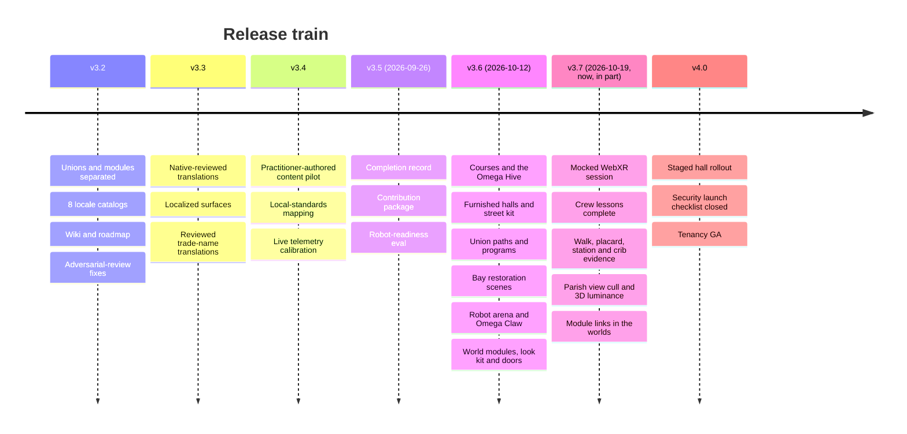

# SmartCiti.X : Trade Craft Academy — roadmap

*powered by AGI Corp*

This roadmap is versioned with the bundle it describes. Every figure in it is
the pack's own (111 halls, 11,000,000 addressable modules, 25,875 authored
objects, 8 districts, 8 locales), and the figures lint holds this file to the
same numbers as every other surface. Dates are planning targets, not
commitments; **exit criteria are the commitments**, and each one is a check a
harness can run rather than a sentence a reader has to trust.

---

## v3.2 — shipped in this release

The consolidation release: one repository, one version, one truth per fact.

| Delivered | Where |
|---|---|
| Union roster separated from the module registry, with a cross-pack verifier | `unions/`, `pack/`, `unions/verify.mjs` |
| Locale catalogs in 8 languages with structural-parity and pack-agreement checks | `i18n/` |
| The languages surface, direction-aware (Arabic renders RTL) | `web/trade_craft_languages.html` |
| Wiki generated from the registries — a page per map, a page per district | `wiki/` |
| Spec v3.2 adopted: §23 adversarial review findings, §24 texture and environment packages | `SmartCitiX_TradeCraft_Academy_Spec.md` |
| Version unified to Adaptive Stack v3.2 / pack 3.2.0 across every surface | manifest, README, generated pages |
| Ten-campus network — three district campuses (Treasure Island–SF, Oakland, New Orleans) plus seven regional-chapter **hub** campuses with no home district of their own (Houston, Chicago, Seattle, Pittsburgh, Denver, Miami, Detroit) — real or AUTHORED WGS84 anchors, recomputed great-circle distances for all forty-five campus pairs, Mapbox-ready GeoJSON | `unions/`, `geo/` |
| Recovered station curriculum rebranded onto halls, skills and rooms, machine-gradable | `stations/`, `archive/` |
| §24 realized: 22 floor finishes resolved hazard-first, per-room conditions merged more-demanding-wins, provenance-tagged (RECORDED/DERIVED/SCHEMATIC) | `surfaces/` |
| The interactive layered map, the **network geomap** (a real WGS84 map, vendored MapLibre GL, on-request USGS orthoimagery and live parcel/footprint fetches), the four-level 3D environment (network → campus → hall → walk) with live condition readouts, and the **network dashboard** reading every platform figure live from its own registry | `web/` |
| Eleven operable training simulators — tower-crane lift, excavator trench cut, forklift yard run, weld bead bench, scaffold bay build, rigging signal call, load chart judgment, pressure washer surface clean, airless paint sprayer finish, **boom lift basket work** and **overhead crane shop move** — each with a five-point pre-shift walkaround, a declared cockpit (dash, synthesized audio, haptics, seat view, an in-headset control mapping), a per-region scenario and a **scripted reference operator** (a deterministic in-page control policy over the seat's own gauges — no model, no network — passing every pass-gated axis on all 33 seat-x-yard combinations at `optimal`, with `novice`/`hurried` as seeded, labelled degradations); schematic physics, deterministic rubrics, bound to real skills in 45 halls | `sims/` |
| The toolroom registry — one crib per district, twelve schematic hand tools each, plus the deterministic crib drill | `tools/` |
| The schools flipped-classroom pack — the model, four grade bands, proposed district partnerships (public-record names only, every one PROPOSED), 45 live flipped units (one per sim-bound hall, so the roster moves with `sims/`) — with an in-app 🎓 Schools panel bidirectionally linked to every hall it names | `schools/` |
| The humanoid avatar locker — 18 standard sections / 336 options plus a 111-look crew section (447 options in 19 sections), a crew look stamping all 111 halls, 22 one-tap character presets, 19 costumes, the original **SmartCiti.X TradeApes** (111, one per hall), 12 emotes — cosmetic only, none graded | `avatars/` |
| The city-records GIS contract (real parcel/footprint authorities, licences and bounded queries) for the three district campuses, plus on-demand real USGS 3DEP elevation lookups — no record copied into the repo, fetched live in the learner's own browser | `parcels/` |
| The metaverse-interchange layer — glTF 2.0 export/import of the avatar and any hall, a complete VRM-compatible humanoid bone skeleton with a driven (not decorative) walk/idle/head-track, and a WebXR layer that is more than an entry button: an XR rig, `local-floor` with a `local` fallback, AR passthrough, controller input into every simulator, snap-turn locomotion and a wrist panel of readouts — every contract held at the source by regex; no session — mocked or real — has been driven in this tree, a mocked-session harness is the next step and is NOT claimed, and no physical headset has run it | `meta/` |
| Nine scripted advisors — eight room- or green-bound guides plus **the Operator**, who lives inside a simulator's own yard and resolves against whichever seat is actually running — a closed 35-question list (the Operator now also quotes the scripted reference procedure), no model, no network, changes no score | `agents/` |
| Generated sky, six weather states, browser-generated ground recipes (zero third-party texture files) and 101 ambient animals across all ten campuses | `world/` |
| The in-world signage system — 19 kinds over 15 shapes, shape-carries-category / colour-carries-provenance / type-carries-rank, view-direction-and-distance scored with one field-of-vision focus target | `labels/` |
| The device-local robotic-training-data recorder (three episode kinds, strictly downstream of a score already final) plus **TRACE**, its off-by-default per-second gauge sampler, and the **SCRIPTED** tier: sim episodes name their `actor`, and the records panel's headless sweep keeps the scripted reference operator's runs as replayable, labelled demonstration episodes through the same recorder — cross-linked with `orbis/` in both directions | `training/` |
| The Orbis synthetic-training-video prompt contract for all 111 union modules, plus two real, separately-runnable companion apps — no key shipped, no network reached from this bundle's own build | `orbis/` |
| The **spatial fabric** — the Academy published as self-hosted static files in the OMBI sense of a spatial fabric: an OGC GeoPose 1.0 Basic-YPR pose (claimed outright, height and heading honestly zero-with-UNKNOWN) for every campus, institution anchor and pinned restoration site, a fabric manifest and a SOM-shaped multi-origin scene graph with per-branch ownership (both shaped after the public deck, registered in `meta/` as NOT claimed), every other operator a separate external origin, no RMAP endpoint, no server, no DID | `spatial/`, `meta/` |
| The 10-world network-roadmap tracker itself: 10 built campuses + 0 candidate metros — the ten-campus target is now fully met, and the registry still carries the actual checklist every one of them cleared to get there | `roadmap/` |
| Path defects of the packaged layout fixed (builders resolve by walking up) | `web/build_page.py`, `web/build_map.py`, `console/build_slice.py` |
| Stale second truths removed (duplicate slice builder, 33-hall-era map data) | — |

---

## v3.3 — trust the words

**Theme:** everything a person reads in their own language is reviewed by a
person who speaks it. The catalogs ship today as *machine-drafted, pending
native review*, and they say so; this release removes that caveat honestly
rather than deleting the label.

**Status:** the machinery this release exists to build is built: a catalog
cannot become `reviewed` without a named human and a date, a hall-name
catalog cannot ship partial, the three public-facing pages hold zero
hard-coded English, and RTL correctness is asserted rather than eyeballed —
each proven by a check, each self-tested against a fixture it must reject.
What this pass does **not** do, and was never going to: review anything.
Building the checker is not the same act as a person reading the Spanish
catalog and signing their name to it, and no amount of machinery changes
that. All 7 non-English catalogs still declare `"translation_status":
"machine-drafted, pending native review"`; this commit added 140 new keys to
every one of them (landing page copy, campus-map chrome) and every new value
is machine-drafted the same way the rest of the catalog already was — none
of it is reviewed, and this PR flips no catalog's status. The release's own
theme — *everything a person reads in their own language is reviewed by a
person who speaks it* — is **not met**, and will not be met by a PR like
this one; it needs the native reviewers ws1 names, which is people, not code.

### Workstreams

1. **Native review of the 7 non-source catalogs.** One reviewer per locale,
   journey-level trade vocabulary where it exists (the German *Geselle*
   ladder, the French *compagnon* tradition). The `translation_status` field
   moves to `reviewed` only with a named reviewer in the commit.
   *Status:* **not started.** The rule that would enforce a reviewer's name
   is built and self-tested (`i18n/catalog.mjs`'s `validateCatalog()`,
   `i18n/test.mjs`, `i18n/validate.mjs`); no reviewer has been named for any
   of the 7 locales, and this pass invented none — a fabricated name would
   be exactly the failure criterion 1 exists to prevent, not a shortcut
   around it.
2. **Reviewed trade-name translations.** The 111 hall names stay in English
   today by design (`i18n/README.md`). This workstream produces per-locale
   hall-name catalogs with the same parity tests, unlocked locale by locale —
   a locale ships hall names only when all 111 are reviewed.
   *Status:* **not started.** The convention and the validator exist
   (`i18n/hall-names/<locale>.json`, `validateHallNames()` — complete-111 or
   absent, `reviewed` with a named reviewer, never partial) and the rule is
   proven against fixtures a human never has to construct twice, but no
   hall-name catalog has been authored; `i18n/test.mjs` holds the rule
   vacuously true today and would catch the first one that ships incomplete.
3. **Localized surfaces.** The landing page and campus-map chrome render from
   the catalogs; the map mirrors correctly under RTL. The console UI strings
   externalize into the catalogs (the control plane stays English-internal —
   telemetry keys are protocol, not prose).
   *Status:* **the landing and languages pages, done; the map's page chrome,
   done; the console, not started.** `web/build_landing.py` and
   `web/build_map.py` no longer carry a single hard-coded English string —
   140 new catalog keys replaced every hero line, mission paragraph,
   investor panel, status-table cell and map legend/title-block/footer
   string that used to be typed straight into the Python (`i18n/README.md`'s
   hard-coded-English-lint section has the full account); `web/build_languages.py`
   was already catalog-only. A source-level read then found the map and
   landing CSS used hard-coded `left`/`right` throughout, which would not
   have mirrored under RTL even though nothing rendered them in another
   language yet; both now use logical properties
   (`margin-inline-start`, `border-inline-end`, `text-align:start`, …), and
   the languages page's locale switcher — which DOES render RTL, for
   Arabic — had a real gap: only the inner `<section dir="rtl">` ever
   flipped; `document.documentElement.dir` stayed `ltr` regardless of the
   selected language, so `document.dir === 'rtl'` was never actually true
   for a reader who picked Arabic. Fixed; see the exit criterion below for
   the numbers. The console's own UI strings are untouched — the control
   plane's telemetry keys stay protocol, not prose, exactly as this
   workstream says, but the console's visible chrome was out of this pass's
   reach given the size of the landing/map externalization alone, and stays
   open.
4. **Wiki localization.** The wiki builder gains a `--locale` mode; district
   pages render per locale from the same registries.
   *Status:* **deliberately not built.** 27 pages × 8 locales generated from
   catalogs that are all still machine-drafted would produce 189 mostly-
   English pages (district names and a handful of UI labels translated, the
   actual page body — hall descriptions, skill text — pulled straight from
   the English registries either way) each carrying a review caveat. That is
   volume without trust, the opposite of this release's theme, so it is left
   open rather than built to make a number go up.

### Exit criteria

- `i18n/test.mjs` gains a rule: a catalog claiming `reviewed` status names
  its reviewer; a hall-name catalog is complete or absent, never partial.
  *Status:* **met.** `i18n/catalog.mjs` exports `STATUSES` (a closed set:
  `source language` | `machine-drafted, pending native review` | `reviewed`)
  and `validateCatalog()`/`validateHallNames()`; `load()` calls the former on
  every catalog it reads, so a bad catalog fails at the moment anything in
  JS loads it, not only when the suite happens to run.
  `i18n/test.mjs` grew from 16 to 31 checks, 8 of them self-tests that
  construct the exact bad catalogs the rule exists to catch — `reviewed`
  with no reviewer, `reviewed` with a reviewer but no date, a 110-of-111
  hall-name catalog, a complete-111 catalog that is not `reviewed` — and
  assert the validator rejects every one, the same proof-by-tampering
  `security/test_sbom.mjs` and `training/build.py`'s balanced-paren reader
  already use on their own guards.
- Landing, map and languages pages carry zero hard-coded English strings
  (a grep-shaped lint, like the brand lint).
  *Status:* **met.** `i18n/lint_hardcoded.mjs` reads the three page
  generators' source (not the built HTML — see the file's own header for
  why that is the sound way to check this) and fails on any user-visible
  text that is not a catalog lookup; it is self-tested against a fixture
  sentence, a hard-coded `alt` attribute and a hard-coded JS string literal,
  and exempts only the brand name and two planned-campus place names
  (`Oakland Training Yard`, `SF Bridgehead` — proper nouns, the same
  exemption class as the untranslated hall names). It runs in
  `verify_all.sh` alongside `brand/lint.mjs`.
- RTL rendering asserted by the layout harness, not eyeballed (§23's lesson:
  a rendering claim needs a rendering check).
  *Status:* **met.** `web/test_rtl.mjs` (17 checks, in `verify_all.sh`)
  holds the source-level half: the languages page's `document.dir` mirror,
  and every physical `left`/`right` CSS rule found in the landing and map
  generators replaced with a logical one, swept broadly enough that a new
  one introduced later fails the test rather than shipping unnoticed. The
  actual-render half is a scratch headless-Chromium proof (Playwright,
  not committed — `verify_all.sh` stays browser-free): on the languages
  page, selecting Arabic set `document.dir` to `rtl` (computed
  `direction: rtl` on `<body>`), moved the honesty box's accent border from
  the left edge (3px) to the right (3px on the right, 0 on the left), and
  moved the first stat tile from x=200 to x=940 in a 1280px viewport — the
  DOM order didn't change, the flex layout mirrored it. On the landing and
  map pages, which have no locale switch of their own, forcing
  `document.documentElement.dir = 'rtl'` moved the nav-links block from
  x≈564 to x≈124 and the map's sidebar from x=0–266 to x=1014–1280 — exactly
  swapped to the opposite edge. `document.documentElement.scrollWidth`
  equalled `clientWidth` (1280) in every case, LTR and RTL alike, on all
  three pages: no horizontal overflow. Nothing failed to mirror; there was
  no finding to fix beyond the two closed above before this proof ran.

---

## v3.4 — content goes real

**Theme:** replace *unverified general practice* with practitioner-authored
content, hall by hall, and let the label retreat only where the work landed.

**Status:** two pieces of load-bearing machinery landed; no content and no
real jurisdiction values did, and this pass did not try to fabricate either.
A design pass proved, by execution rather than by reading, that the ACP-08
parity monitor (`bus/safeguards.mjs`) reported `clean: true` — and advanced
its own staleness clock — over zero cohorts, over every cohort under
`minCohortN`, and over exactly one usable cohort with nothing to compare it
against; the rollout lanes (`ops/rollout.mjs`) consult exactly that monitor
before advancing a wave. `run()` now returns a third fact, `observed`,
distinct from `clean` — "did we find a problem" is no longer the same
question as "did we look" — `promotionsAllowed()` fails closed whenever the
most recent run did not observe, and `lastRunAt` (what `ageDays()` reads)
only advances on an observed run, so a parity job that executes on schedule
but sees nothing no longer silences the "parity job cannot run" stop
condition either. Five new tests exercise the zero-cohort, every-cohort-
under-threshold, one-usable-cohort, legitimate-two-cohorts-agreeing and
staleness-interaction shapes; `bus/test_safeguards.mjs` grew from 15 to 20
checks. Separately, `pack/hall_signoff.mjs` gives criterion 1 the mechanism
its own wording ("the per-hall honesty flag") assumed already existed and
did not: a closed set of `content_status` values, a hall claiming
`"practitioner sign-off"` must name the practitioner(s) and a date exactly
as `i18n/catalog.mjs`'s reviewer rule requires, and an absent status
inherits the manifest's global caveat rather than being silently exempt
from it. `pack/verify.mjs` grew from 19 to 29 checks, 6 of them self-tests
constructing the exact bad claims the rule exists to catch. Neither piece
touched a single one of the 111 hall records — all still inherit the
caveat, by design; see criterion 1 below. Nothing here talks to a real
learner, a real cohort, or a real jurisdiction's code, and the release's own
theme is not met by a PR like this one.

### Workstreams

1. **Flagship authoring pilot.** The four console-slice halls first —
   Ironworkers, Electrical Workers, Welding Trades, Crane Operators. Journey-
   level practitioners author against the existing skeleton (levels, strands,
   tiers); the manifest's honesty block becomes per-hall, so a verified hall
   stops carrying the caveat and an unverified one keeps it. The masonry
   family has a head start: the recovered pre-rebrand yard curriculum
   (`archive/bac_yard_stations.json`, 25 machine-gradable stations — see
   `wiki/Upgrade-Candidates.md`) seeds `bricklayers` and its neighbouring
   halls once practitioners have reviewed it. A coverage check (2026-09-13)
   found only 11 of 111 halls carry any yard station today, all from that
   one recovered set — Energy & Utilities and Transport & Mobility hold
   zero, with no surveyed candidate source for either yet (`wiki/
   Upgrade-Candidates.md` §6); a future wave of this workstream should name
   a flagship hall in each.
   *Status:* **not started, and the mechanism it depends on is now
   deliberately built ahead of any content to fill it.** `pack/hall_signoff.mjs`
   gives the manifest's honesty block a per-hall shape: `content_status` is a
   closed three-value set (`unverified general practice` | `pending
   practitioner authoring` | `practitioner sign-off`), a hall claiming
   sign-off must name real practitioner(s) and a `signed_off_at` date or the
   build refuses it, and an absent `content_status` inherits the global
   caveat rather than being silently exempt. No practitioner has been named
   for any hall, and this pass invented none — a fabricated name would be
   exactly the failure the rule exists to prevent, the same shape as
   v3.3 ws1's unmet reviewer criterion. All 111 halls still carry
   `content_status: undefined` and the global caveat applies to every one.
2. **Local-standards mapping (§24.3).** The texture and environment values
   ship as general good practice with the absence of code references
   asserted. This workstream adds a jurisdiction overlay format: a deployment
   names its jurisdiction, and every illuminance/ACH/PPE value resolves
   against the local standard or fails loudly — never silently defaults
   (§23.1's one-sentence pattern: a default value is a policy decision).
   *Status:* **deliberately not started; see the exit criterion below.**
3. **Calibration from live telemetry.** The dial and gates run today against
   simulated learners (ACP-14/15). Shadow-mode deployment feeds the parity
   monitor (ACP-08) real cohorts; item difficulty recalibrates from evidence
   with the audit trail the bus already writes.
   *Status:* **not started — no shadow-mode deployment and no real cohort
   exists in this repo.** What this pass did close is a hazard that would
   have undermined this workstream the moment it started: a shadow-mode
   network with no enrolled learners, or too few per cohort, used to be told
   by `ParityMonitor.promotionsAllowed()` that promotions were fine, having
   compared nothing. See the release status paragraph above and criterion 3
   below.
4. **Adversarial review cadence.** §23.5's conclusion operationalized: an
   independent adversarial pass on every minor release, findings filed as
   spec sections, not just fixes.
   *Status:* **not started as a cadence.** This PR was itself one more
   design-pass-then-fix cycle in that spirit (spec §23.1's own catalogue
   named the defect; this closed it), but no recurring schedule exists yet.

### Exit criteria

- ≥1 hall's content signed off by named journey-level practitioners; the
  per-hall honesty flag verified by `pack/verify.mjs`.
  *Status:* **not met — and not attempted.** The flag itself now exists and
  is verified: `pack/verify.mjs` fails the build if any hall claims
  `practitioner sign-off` without naming a practitioner and a date, and
  confirms today that not one of the 111 halls makes that claim. Meeting
  this criterion needs a real journey-level practitioner willing to put
  their name on a hall's content, which is a person, not a PR.
- A jurisdiction overlay validates end-to-end for one real jurisdiction with
  every value sourced or explicitly waived.
  *Status:* **not met, and deliberately left that way.** Meeting it needs
  real cited values from Title 24, OSHA 1926 or a real AHJ for illuminance,
  air changes, noise and PPE. This sandbox cannot fetch them, and they must
  not be typed from memory into a platform whose surface pack currently
  proves the opposite — `surfaces/build.py`'s own honesty block states
  "general good practice, not a code reference; no figure is read from any
  jurisdiction's standard." A wrong safety value that looks sourced is worse
  than an honest gap, so this criterion stays open rather than closed with
  invented numbers.
- Parity monitor green over real cohorts — with the §23.1 fix proven: it can
  never report green over zero cohorts.
  *Status:* **the §23.1 clause is met; the real-cohorts clause is not, and
  the two are not the same claim.** `bus/test_safeguards.mjs` now proves, by
  construction, that a zero-cohort run, an every-cohort-under-threshold run
  and a one-usable-cohort run are all refused by `promotionsAllowed()`
  (three new tests), that a legitimate two-cohort agreement still reads as
  green (one more), and that an empty run does not silence the "parity job
  cannot run" stop condition (one more) — `ops/rehearsal.mjs`'s wave-1
  harness, which drives that same stop condition through a real `Scheduler`,
  still passes unchanged. No real cohort exists anywhere in this repo;
  everything above runs against constructed fixtures and seeded synthetic
  data, exactly as `ops/rehearsal.mjs` says of itself.

---

## v4.0 — the campus opens

**Theme:** staged, observable, reversible rollout — the ops pack's lanes and
gates doing their job on real halls.

### Workstreams

1. **Staged hall rollout.** Waves per `ops/rollout.mjs` lanes: canary (1
   hall) → wave (5 halls) → the full network (111 halls, read live from the
   pack). Each wave holds its dwell window (no `Infinity` defaults —
   §23.1), passes its stop conditions, and can roll back without data loss.
   *Status:* `ops/rehearsal.mjs` drives one content rollout through every
   gate — the dwell gate with no observation reported, a red parity ticket
   and its close, an ACP-08 halt and the auto-rollback it triggers, the
   dial-params shadow run, a parity job that never runs (driven through the
   real `Scheduler`, not faked) halting the network on its own, and the full
   canary → wave → full walk — against seeded synthetic cohorts, with every
   step asserted against the resulting audit trail rather than a return
   value alone. That proves the lane machinery enforces what it claims.
   It does not ship anything: there is no deployment and no real learner
   behind any hall count in that run, so a rehearsal against synthetic
   cohorts is not a wave shipped to real halls, and the exit criterion below
   stays **not met**.
2. **Security launch checklist.** Every open item in `SECURITY.md` closed or
   explicitly accepted by name; deny-by-default authz, tenant isolation and
   rate limiting re-verified against the §23.1 fail-open classes.
   *Status:* this pass closed what can be closed in-repo — the ACP-13 cost
   governor's "specified, not built" claim corrected (it is built and tested
   in `ops/`); two §23.1 fail-open dwell defaults closed with absent-input
   tests (`ops/rollout.mjs` `advance()` no longer opens a lane on an
   unreported dwell; `control/hints.mjs` `request()` and its `bus/session.mjs`
   pass-through no longer serve a hint on an unreported dwell); an SBOM
   (`security/build_sbom.py` → `security/registry/sbom.cdx.json`, CycloneDX
   1.5, verified by hash against `web/vendor/` on every run); the contest and
   abuse routes (`security/contest.mjs`: `gate.contest`/`gate.review`,
   `abuse.report`/`abuse.triage`, no agent role holds any of them); and
   `SECURITY.md` deduplicated (the pack copy is now a pointer). **Still
   open:** authentication, transport and storage encryption, persistence and
   backup, secrets management, CI dependency/container scanning (a workflow
   change the maintainers must approve), the external penetration test, the
   staffed incident-response rotation and the vulnerability-reporting
   address — every one needs infrastructure or people outside this tree, and
   none has a named owner yet.
3. **Tenancy GA.** Multi-tenant deployments with the erasure and retention
   guarantees the privacy pack asserts; per-tenant locale defaults.
4. **VR sim modality pilot.** The browser simulator layer (`sims/` — eleven
   machines now: tower-crane lift, excavator trench cut, forklift yard run,
   weld bead bench, scaffold bay build, rigging signal call, load chart
   judgment, pressure washer surface clean, airless paint sprayer finish,
   and — this milestone's widening — the boom lift basket work and the
   overhead crane shop move, all deterministic-rubric and skill-bound, each
   with a scripted reference operator that drives it at the rubric-passing
   level and generates SCRIPTED demonstration episodes for the `training/`
   recorder). **What shipped:** the 3D environment now carries a real XR
   rig (the camera's parent; walking, seat poses and snap turns move the
   rig, never the camera), a `local-floor` space with a `local` fallback,
   AR passthrough with the drawn sky, ground and fog suppressed, a
   controller adapter that lands thumbsticks, trigger, grip and face
   buttons in the same key state a keyboard fills through each seat's
   declared `xr` mapping, a wrist panel of readout signs off the same
   gauges the dash shows, and the scripted operator watchable from inside
   the session — so every seat, the campus, the halls and the restoration
   walks run in-session against the interiors/§24 environment packages.
   **What is honestly not done:** every XR contract is held at the source
   by regex (`web/test_3d.mjs`, `meta/test.mjs`), and one seat (the rigging
   signal call) is now also driven end to end in a MOCKED WebXR session in
   headless Chromium (`xr/test_session.mjs --browser`: three.js's
   `WebXRManager` over a fake session, frame and input sources); no session
   on a physical headset has been driven in this tree. No physical headset
   has run it. Hand
   JOINTS are read for four gestures (pinch, point, open palm, palm up),
   proven against synthetic joint positions only; hands are not rendered.
   three.js r160 cannot resize the XR framebuffer mid-session, so the
   resolution ladder applies at the next session start while foveation
   steps live. Simulator results stay
   formative until the assessment gates' unaided verification contract
   says otherwise, and a scripted operator's run is never a learner's
   result at all.
5. **Metaverse-browser interoperability.** `spatial/` already publishes
   the Academy as a self-hosted spatial fabric with real OGC GeoPose 1.0
   poses and an OMBI-shaped manifest and scene graph that are honestly
   NOT claimed as conformant. This milestone closes that gap only when it
   can be closed honestly: validate the manifest and SOM against the
   normative OMBI texts once they are published and reachable, load the
   fabric in an open metaverse browser (Sneeze / Artemis) and record the
   result, and then — and only then — move `ombi-spatial-fabric`,
   `ombi-som` and (if a server is ever run) `rmap` from `not_claimed` to
   `standards` in `meta/`. Heights and headings stay zero-with-UNKNOWN
   until a cited measurement exists for them.

### Exit criteria

- Rollout lanes complete for wave 1 with audit evidence; cost governor live
  and provably unable to throttle the control plane.
  *Status:* the cost governor half is met — `ops/jobs.mjs`'s `CostGovernor`
  is built and tested, and the control plane is structurally un-throttleable
  (`bus/test_safeguards.mjs`, `ops/test.mjs`, `ops/fuzz.mjs`). The lanes half
  is not: `ops/rehearsal.mjs` rehearses every gate end to end with audit
  evidence against seeded synthetic cohorts, which is what this repo can
  honestly produce with no deployment and no real learners, but a rehearsal
  is not wave 1 complete. **Not yet met.**
- Security checklist at zero open unaccepted items.
  *Status:* **not met** — `SECURITY.md` now carries the checklist as a status
  table; the in-repo items are built and tested, the remaining items need
  external infrastructure, people or a maintainer-approved CI change, and its
  "Accepted by" column is empty because this pass names no owner.
- One VR sim module running against a §24 environment package end to end.
  *Status:* every sim module is wired to run in a WebXR session against the
  interiors/§24 environment packages, held at the source by regex, and one
  seat (the rigging signal call) has since been driven end to end in a MOCKED
  WebXR session in headless Chromium against its §24 yard surface
  (`xr/test_session.mjs --browser`); no session on a physical headset has been
  driven. Mocked half met, headset half not met, so this criterion is **not
  yet met**.

---

## v3.5 — verifiable training (shipped in this pass, 2026-09-26)

Everything below is measured by a suite in `verify_all.sh` and was verified
from the exact archived tree of the commit that shipped it. Numbers are the
registries' own; none is typed here from memory.

| What shipped | Where | Status |
| --- | --- | --- |
| A completion record (`tc-completion/1`) exported from device-local progress, digest-bound, held to the registries by fifteen named rules, optionally signed by the learner's wallet (EIP-191 over a structured message; the address recovered through the sign-in page's own secp256k1 and keccak) | `completion/`, `web/build_progress.py`, `auth/recover.mjs` | shipped; 24 of 32 lessons completable, 8 not (the crew episode records neither seat nor muster); signature = a key, not a person; nothing on any chain |
| An eval of whether completion can be verified at all: 65 of 135 lesson steps record an episode, 70 do not; 0 lessons fully verifiable by episode, 32 partly; 27 of 111 halls have any lesson | `evals/registry/evals.json#completion_evidence` | shipped |
| Training depth on all three map surfaces: lessons, seats, flipped units, sign-off (0 of 111), completability per hall; lesson paths and ladder edges drawn; campus rollups and anchor provenance (41 RECORDED of 69) on the geomap | `web/build_map.py`, `web/build_interactive_map.py`, `web/build_geomap.py` | shipped; layer labels on two surfaces are registry field paths until the catalogs hold keys |
| Every campus scored in a browser (all ten under every cap); floors judged only on the flagship where they were calibrated | `web/eval_campuses.mjs`, `rnd#eval.campuses_scored` 10/10, `#eval.campus_floors_judged` 1/10 | shipped; New Orleans shows 9 signs for 28 halls (recorded, under investigation) |
| Colour legibility measured over 2,046 finish-by-sign pairs; the text-on-plate rule passes everywhere; nothing recoloured by taste | `surfaces/`, `labels/` | shipped |
| Six custom training spaces composed only from the bundle's own assets, validated against the rooms the 3D builder lays out, with derived PPE and cost | `spaces/`, `web/build_spaces.py` | shipped; declared, not yet walkable (at that pass; a walk-through in the 3D page since wave 22, equipment shown as markers) |
| The headset layer reviewed by mutation: two headset-only faults fixed, fourteen source checks added, and one truth everywhere - no session, mocked or real, has been driven | `web/build_3d.py`, `meta/`, §v4.0 above | shipped; the mocked-session harness is the next step and is not claimed |
| A consented, digest-bound, optionally wallet-signed contribution package of recorded episodes for agent and robot training, with a 16-rule verifier and a page that uploads nothing | `contrib/`, `web/build_contribute.py` | shipped; no platform reached |
| An honest roster of agent protocols and wallet rails, every entry configured false, every spec probe refused by the proxy; two names recorded as unidentified rather than guessed | `protocols/` | shipped; nothing integrates |
| A robot-readiness eval: every seat "observation-only" (a 1 Hz trace of gauges with no control state per sample), with the fields named that would move it up | `evals/registry/evals.json#robot_readiness` | shipped; no episode recorded from a learner, no agent trained |

### Open after this pass

- The eight lessons that hold a crew step cannot complete until the crew
  episode records `seat` and `muster` (`training/`), or the lesson step stops
  carrying them (`lessons/`). Not a verifier problem. (At the 2026-09-26 pass; carried to
  v3.7, workstream 2: 23 of 139 lessons then, 0 since `d8094b8`.)
- No page links to the spaces or contribute pages yet. (Stale when written: the site navigation on every page has
  linked both since `91f34b8`; the wave 22 landing added checks for it in `web/test_nav.mjs`.)
- The map layers' labels on two surfaces are registry field paths, and the
  XR HUD's 15 new keys are machine-drafted in seven locales, as those catalogs
  already declare.
- A mocked WebXR session harness driving `renderer.xr` in headless Chromium
  now exists for one seat (`xr/test_session.mjs --browser`, run in the browser
  round, not `verify_all.sh`); the other ten seats are held at the source by
  regex and no physical headset has run any of it. (Carried to v3.7,
  workstream 1.)
- The jurisdiction overlay stays deliberately not started (see v3.4). The
  compliance ledger this pass adds is the bundle's own rules, not a code
  reference.
- No cohort, no learner record, no agent or robot trained, no platform
  reached, nothing on any chain. Every registry that could be read as
  claiming otherwise says this in its own honesty block.

---

## v3.6 — the worlds (shipped 2026-10-12)

**Theme:** the walkable worlds get people, places, paths and a measured look,
and the robotics work gets an honest, small, measured learning result. This
release covers waves 16 to 19, `f20ca33` to `83db20b`. Each row cites the
commit that carries it; each number is the registry's own or printed in that
commit's message, none typed here from memory.

| What shipped | Where | Status |
| --- | --- | --- |
| Trade Craft **courses**: 122 courses (111 trade, 11 strand) over 139 lessons and 568 steps, plus one supplement per lesson (139 of 139: 2,486 glossary terms, 707 self-check questions whose answers are registry ids, worksheet lines for 568 of 568 steps) | `courses/`, `web/trade_craft_courses.html` | shipped, `f42a9b0`; AUTHORED by stated rule; no scenario declares a duration so 0 minutes are stated; unverified general practice; certifies nobody |
| The **Omega Hive**: 197 agents (9 advisors, 20 crew roles, 168 guides) joined to a locker avatar, an AUTHORED personality and a device voice profile, with 1,133 lines quoted from their source registries; a deterministic council of 3 to 5 agents | `hive/`, `web/trade_craft_hive.html` | shipped, `f42a9b0`; SCRIPTED, no AI model; the device's own speech synthesis, only on a click, with Mute; classroom mode seats 79 play-safe agents, starts muted |
| Hive agents **embodied in the worlds**: 3D advisors and crew wear their roster outfit, an AUTHORED trait table picks the idle gesture and the opening line, parish guides wear hair, sleeves and tool belt, a council point stands on the flagship plaza | `web/build_3d.py`, `web/build_parishes.py`, `hive/` | shipped, `c066319`; every line is still a registry quote; `web/test_hive.mjs` 77 at landing, 53 headless mutations failed by name |
| Holodeck packs list Courses and the Omega Hive, each recounted from its own registry | `holodeck/`, `web/trade_craft_packs.html` | shipped, `ae17cb3`; 30 packs, 29 shipping, 1 proposed; no prices |
| Building and campus **dressing**: surface textures by device tier, pooled luminaire housings, a header-sign atlas per hall, name boards on all 111 building fronts, instanced street lamps and plaza benches; then rooftop units, door hoods, glazing mullions and campus trees | `web/build_3d.py` | shipped, `f42a9b0` and `43c063d`; flagship 32 trees; no ceiling raised |
| **Furnished hall interiors**: the props registry's 192 district fit-out pieces placed by room type with a 1.5 m aisle; all 111 halls swept | `web/build_3d.py`, `web/test_scenes.mjs` | shipped, `c066319` and `43c063d`; 7 to 15 pieces per hall, 1,130 in all, 1 drawable per hall; the dearest hall is at 14,600 of its 15,224 triangle cap |
| **Device-tier world textures** on the parish, Bay and wilds pages (high 1,024 px, ultra 2,048 px), inside a stepped memory budget | `web/build_parishes.py`, `web/build_bayworld.py`, `web/build_wilds.py`, `web/eval_worldtex.mjs` | shipped, `c066319`; draw calls and triangles equal on every tier; frame time measured only on software rendering |
| **Street kit** in the parish and Bay worlds: porches, fences, hedges, mailboxes, street-name signposts, hydrants, collection boxes, bus-stop shelters, one pooled mesh of at most 300 boxes within 90 m | `web/build_parishes.py` | shipped, `834434b`; AUTHORED placement rule; +1 draw call in walk views, 0 in overviews; `web/test_parishes.mjs` 135, 19 mutations failed by name |
| **Recorded ground**: a same-origin geomap hillshade shaded at build time from the vendored USGS 3DEP grids (DERIVED from RECORDED), its lit side fixed to the shadow side's alpha (dark-style relief contrast 5.91 to 8.96 at Bay zoom 10), and an AUTHORED San Francisco shore shelf giving Dive/ROV a depth at 1,360 of 1,360 samples | `elevation/hillshade.py`, `web/build_geomap.py` | shipped, `f20ca33` and `c066319`; `web/test_geomap.mjs` 103 |
| Terrain relief measured explicitly off and on, and parked while the camera is in the overview | `web/eval_relief.mjs`, `web/terrainkit.py` | shipped, `f20ca33` and `ae17cb3`; relief stays **off** by default: 12 rows still fail the flat-ground rule (land at y = 0) which relief breaks by construction; no row changed |
| Robotics lab **replay viewer** (all 240 reference traces re-run equal their rows) and an AUTHORED litter-sort level 4 "reachable" | `robotics/`, `web/trade_craft_robotics.html` | shipped, `f20ca33`; level 4 passes 20 of 20 seeds, 80 of 80 items; levels 1 to 3 and their caps unchanged |
| Wilds **flora**: 9 generally named ground plants on all 4 wild worlds as one instanced mesh | `web/build_wilds.py` | shipped, `f20ca33`; every `web/eval_wilds.mjs` calls row inside its unchanged ceiling |
| **Union-hall pathways**: one ordered path per hall, 111 in all, 604 path steps over 139 lessons, with seats (45 halls, 79 bindings), crews (38 halls), tool crib and Omega Hive advisor | `unionpaths/` | shipped, `aff302b`; DERIVED by stated rules; a union named is not a partner or affiliate; no hours, wages, credentials, membership or affiliation stated, and the build refuses a record that carries one |
| The **union directory**: one card per hall with its path, filters by district, cohort and focus | `web/trade_craft_unions.html` | shipped, `c2d6a97`; `web/test_unions.mjs` 38 |
| **K-12 programs and nonprofit sectors**: pathways over 4 grade bands, 105 teacher program cards, 4 nonprofit sectors, in 8 locales | `programs/`, `web/trade_craft_programs.html` | shipped, `aff302b` (registry) and `c2d6a97` (page); districts, programmes and organisations are **PROPOSED**; the UN path is PROPOSED and not affiliated; nothing is accredited |
| **Deep Bay restoration scenes** at the 8 walkable RECORDED sites (marsh bands, mudflat, salt-pond levees, riprap, living shoreline, planting) with SCRIPTED restoration crews quoting 179 lines; levees, riprap and sills solid to the walker | `web/restoscene.py`, `web/test_restoscene.mjs` | shipped, `aff302b` and `c2d6a97`; AUTHORED habitat, at most 15,940 triangles, near the sites only; 276 berm boxes at the South Bay salt ponds; federal cleanup sites stay non-walkable with their reason verbatim |
| The SEO **whitepaper page**, every figure pointing at its registry, with structured data that carries no rating, review or price | `web/smartcitix_whitepaper.html` | shipped, `aff302b` and `c2d6a97`; `web/test_whitepaper.mjs` 37, `web/test_seo.mjs` 19; public only when this branch is merged to the deploy branch |
| The **robot model arena** (`tc-arena/1`): carded policies on 4 world tasks, every level and seed, with bootstrap 95% CIs and paired win rates; one small behaviour-cloning MLP (24-16-4, 468 weights) trained on 130 SCRIPTED episodes | `robotics/arena/`, `web/test_arena.mjs` | shipped, `c2d6a97`; held-out seeds 11 to 20: SCRIPTED reference 0.592 [0.515, 0.677], cloned policy 0.423 [0.339, 0.508], paired win rate 0.108, uniform random 0; it never learned grip timing; **not a language model**, no learner's data, **no LLM trained**; the 11 sim seats are excluded (no headless runner) |
| **Omega Claw**: five SCRIPTED orchestration agents, a 1,040-run refereed tournament (0 referee disagreements), and a 260-sample instruction-conditioned dataset (splits 208/26/26 by seed, 140/60/60 by task family, 0 duplicate trajectories) | `robotics/claw/` | shipped, `c2d6a97`; no AI model; `robotics/claw/test.mjs` 58; learner episodes merge only through the datashare consent scope; no LLM or VLA trained |
| A **robot yard** in the parish and Bay worlds: one AUTHORED rover in a 12 m yard replaying the SCRIPTED litter-pickup reference policy at a fixed 10 Hz over 6 seeded targets | `web/build_parishes.py` | shipped, `3a5a889`; +1 draw call and 156 triangles in walk view; stores, sends and listens for nothing; `web/test_parishes.mjs` 140 |
| **World training modules**: 16 modules and 191 steps over 3 worksite districts, 8 walkable Bay sites, 4 wilds worlds and the robot yard, each greeted by an Omega Hive agent | `modules/`, `web/test_worldmodules.mjs` | shipped, `83db20b`; AUTHORED by rule; 8 candidates refused with the reason printed; 0 durations, certifies nobody; `modules/test.mjs` 37, `web/test_worldmodules.mjs` 34 |
| The **look kit**: one physically based look (sun by elevation, per-class roughness and metalness, tone mapping, colour space) across the 3D campus, parish, Bay and wilds pages | `web/lookkit.py`, `web/test_lookkit.mjs` | shipped, `83db20b`; draw calls and triangles equal on all four; mean frame luminance 3D network 26.2 to 28.2, parish 95.7 to 89.2, Bay 97.2 to 95.3, wilds 47.8 to 43.6; `web/test_lookkit.mjs` 67 |
| **Doors in and out of the worlds**: keyboard-reachable doors from the parish (29) and Bay (9) walks into 3D interiors and restoration scenes, a skip link, and a back link from every 3D view | `web/test_access.mjs` | shipped, `83db20b`; 28 union hall cards open their parish door; 202 Programs links open their place in a world; 40 of 40 mutations caught by name; `web/test_access.mjs` 62 |
| Evaluation ergonomics: `eval_parishes --part=1\|2\|3` and `eval_bayworld --part=1\|2` so each part fits one browser run | `web/eval_parishes.mjs`, `web/eval_bayworld.mjs` | shipped, `f42a9b0`; `web/test_evalparts.mjs` 14 |
| The whole tree held to its checks: 7,201 passing at `83db20b` (6,337 at `f20ca33`) | `verify_all.sh` | shipped, `83db20b`; the figures and brand lints, both staleness guards and every pack suite in one exit code |

### Open after this pass

- **No cohort, no learner, no learner episode.** Every completion, pathway
  and program above is a derived plan, not a record of anyone finishing it.
  0 of 111 halls carry a named practitioner's sign-off.
- **No LLM trained.** The one trained model is a 468-weight cloned policy on
  SCRIPTED episodes; it scores 0.423 against the reference's 0.592 on held-out
  seeds and never learned grip timing. Omega Hive and Omega Claw are SCRIPTED.
  (At that pass. v3.7 workstream 5 added a second cloned policy in wave 22;
  still no language model.)
- **No session on a physical headset has been driven.** One seat is driven in a MOCKED session
  in headless Chromium; every other WebXR contract is still held at the source
  by regex. Hand joints are proven against synthetic positions only.
- **Partners are PROPOSED.** Districts, programmes and organisations on the
  Programs page, and every union on the directory, are named without an
  agreement; the UN path is PROPOSED and not affiliated; nothing is accredited.
- **Parish 22051 border frame row is over its ceiling** (200 against 166.6 ms
  at `3a5a889`, 233.3 in another run) on load-bound software rendering. Its
  draw-call and triangle rows hold; no ceiling was moved; there is no
  measurement on a real GPU.
- **The 3D network view is below its luminance band**: mean frame luminance
  28.2 against the [40, 215] band (it was 26.2 before the look kit).
- 23 of 139 lessons cannot complete: the crew episode still records neither
  seat nor muster (`completion/registry/completion.json`, 116 completable).
- The 16 world modules are listed on the Courses page but not yet linked from
  inside the worlds they teach.
- Terrain relief stays off by default (12 rows fail the flat-ground rule).
- Pages go public only when the branch merges to the deploy branch.

---

## v3.7 — deep worlds (wave 20, 2026-10-19: shipped in part; the rest planned for November 2026)

**Theme:** close the gaps the v3.6 list names, each with a check a harness can
run, and add nothing that needs a person, a cohort or a headset. This release
reaches only the rungs this tree can honestly reach: a *mocked* XR session is
not a headset session, and a lesson that *can* complete is not a lesson a
learner completed.

Status key: **shipped** names the landing commit; **partly met** says exactly
which half landed and which did not; **planned** rows have not started. Work
that landed in the wave 20 landing after `d8094b8` is named as such, because a
commit cannot name its own sha.

### Workstreams

1. **Mocked WebXR session harness** — *partly met, `d8094b8` and `b098362`, then wave 21.* Drive the 3D
   page's `renderer.xr` in headless Chromium under a fake `XRSession` (frame
   loop, input sources, reference spaces), so the XR contracts stop being held
   by regex alone. *Landing commit:* `d8094b8`: the rigging signal call seat is
   driven from Enter VR to completion and back in a MOCKED session. Wave 21
   added a seat harness (`--browser --seats=A..H`): load-chart and scaffold-bay
   reached completion in one MOCKED session (scaffold-bay with one failing
   gauge check, not diagnosed), crane-lift reached its key state only, and the
   other seven seats have not been run. Wave 22 measured all eleven seats in
   MOCKED sessions (headless Chromium, software GL, load average 4.5 to 6.4,
   5 to 18 session frames per second): four reached their own result panel
   from the controllers with a Passed verdict (rigging signal call, load chart,
   scaffold bay, tower crane lift); the overhead crane reached its panel with a
   retry verdict (sway 0.99 m against 0.6); six reached key state only
   (pressure washer, airless sprayer, weld bead, boom lift, forklift run,
   excavator trench) and ran out of wall clock at that frame rate. The scaffold
   bay's failing gauge check was the harness and is fixed without weakening it.
   The seat physics stepped on the raw frame time while the reference runs
   were tuned at 1/60 s. Wave 23 tested that headless: steady low frame rates
   did not reproduce the crane's sway (0.33 to 0.38 m at 5 to 18 fps), frame
   stalls of 0.6 to 2.1 s did (23.7 m), and at 3 to 5 fps three seats never
   finished. The seat and its scripted operator now step on a fixed 1/60 s
   (a capped accumulator that carries the remainder), and the same headless
   sweep gives all 11 seats the same Passed verdict at every frame-time
   sequence from 3 to 120 fps, jitter and stalls included. In MOCKED sessions
   after the change (software GL, 8 to 15 fps) five seats Passed (load chart,
   scaffold bay, tower crane lift, weld bead, pressure washer); the overhead
   crane Passed (sway 0.52 m) only with a longer time cap than the committed
   one, because its reference run is 47 s; the forklift completed with a retry
   verdict (2 cones, one 1.9 s stall); the boom lift and airless sprayer did
   not finish inside their caps; the excavator reached key state as declared.
   The scripted coach still reads its input once per frame, so a low frame rate
   still hurts the driver, not the physics. The coach time caps in
   `xr/seat_batches.mjs` (overhead crane 45 s against a 47 s reference run;
   boom lift 50 s) are left as committed: a longer cap is a product decision
   about how long a task may take, made by the project owner, not by the
   harness. Displays above 60 Hz now see the
   seat step at 60 Hz, which may judder in a headset; not yet measured. No
   physical headset has run any of it.
2. **Crew episodes record seat and muster** — *shipped, `d8094b8`.* The
   crew episode in `training/` records the two fields the completion verifier
   asks for, so the 23 lessons with a crew step can complete. The lessons are
   not weakened: the crew step still records an episode. *Landing commit:*
   `d8094b8`: lessons not completable 23 -> 0 of 139, the verifier unchanged.
3. **Parish frame cost and 3D-view luminance** — *partly met.*
   Reduce the cost behind the parish 22051 border frame row and lift the 3D
   network view's mean luminance into its band, both with draw calls and
   triangles unchanged and no ceiling or band edge moved. *Landing commit:*
   `d8094b8` (fabric view cull) and the landing after it (guide cull; per-view
   exposure for the network and campus views). The 22051 border row passes at
   load 3-4 and fails at load 5 and above; the 22103 rows fail at load 3-4 as
   they did at `83db20b`. Wave 21 skips the water plane when no water can be
   seen from the eye (one draw call fewer on inland views); its frame-time
   effect is not yet measured. No ceiling was moved. Wave 22 committed the
   luminance eval (`web/eval_look.mjs`): it holds the shares on the 3D scene
   with the page's overlays hidden, against `83db20b` measured in the same
   harness, and reports the whole frame beside it.
4. **Module links inside the worlds** — *shipped, `d8094b8` and wave 21.* Each of the
   16 world modules is reachable from the world it teaches (keyboard and
   pointer), extending the doors of v3.6. *Landing commit:* `d8094b8`: 13 of the
   16 (8 Bay restoration sites, 4 wilds worlds, the robot yard); wave 21
   linked the 3 worksite-district modules from the work sites page, the Bay
   restoration panels and the parish and Bay campus doors: 16 of 16.
5. **A learned policy that bins something** — *met, wave 22.* The
   cloned policy never learned grip timing, so it bins nothing in litter sort.
   A second carded policy (`bcg`, an MLP 26-32-4: the first model's 24
   features plus two that expose the gap to the gripper's reach, and a
   class-weighted grip head) is trained on SCRIPTED episodes of seeds 1 to 10
   only; its width, epochs and features were chosen on seeds 1-6 against 7-10,
   and the held-out seeds were run once, after fitting. It ties its scripted
   teacher on items binned and does not beat it; the teacher caps what it can
   reach. Not a language model, no learner's data.
6. **Spaces walkable and linked** — *met for walking by a scripted walker on a planned route, wave 23.* The six custom
   training spaces were declared, not walkable (v3.5). They now open in the 3D
   page by `?space=<id>&hall=<slug>`, placed as AUTHORED designs in the room of
   their strand; a walker driven by the page's own walk step reached the room
   in each of the 10 (space, hall) pairs in a browser, and the every-room hall
   test held on 4 of them in wave 22 and on all 10 in wave 23, where the
   adjacent-room chain also held in a browser. The walk follows a route
   planned over the page's solids; it is not a person at a keyboard. Seats,
   stations, cribs and signs are marker pads,
   not solid. The pages were already linked from every page's site
   navigation (since `91f34b8`); the wave 22 landing checks it.
7. **Relief on, honestly** — *met by measured runs, wave 22; relief stays
   off by default.* A relief-aware ground rule sits beside the flat one: flat
   vertices at exactly 0, relief patches on the lattice and never below 0, the
   camera at eye height over the ground under it, the overview flat. The flat
   rows are unedited and still judge the default page. A live run found that
   land meshes of streamed-out parishes keep a stale relief patch in memory
   (not drawn). Wave 23: the audit now also judges land meshes held outside
   the scene, and a parish that streams out gives its relief patch back. A Bay
   run that streamed a parish out and back in twice found the held patch at
   6,194 to 6,654 vertices before the fix (about 277 to 311 KB per mesh) and 0
   after (12.7 to 25.1 KB), with the patch rebuilt on re-entry; parish and Bay
   relief runs pass with no held-mesh findings. The stream run covers the Bay
   page only.
   The default stays off by decision. One `eval_parishes --part=1` run each
   way, minutes after a container restart (load 0.5 off, 2.5 on), put the
   worst row (22051 border) at 266.7 ms off and 316.7 ms on, both over its
   166.6 ms limit. That disagrees with the wave 20 and 21 runs above, where
   the same row passed at load 3-4: single runs of this row do not agree, so
   it is not explained by load alone, and neither figure is taken as its
   state. The decision does not rest on that row. It rests on two things:
   on the same view in the same pair of runs relief added about 50 ms, and
   turning it on would hand the default page from the flat-ground rows to the
   newer relief-aware rule. Revisit after repeated runs of the 22051 border
   row, off and on, agree.
8. **Walk and placard steps record episodes** — *shipped, the landing after
   `d8094b8`.* A walk episode when the walker enters a room a lesson names, a
   placard episode when its panel stays open for its dwell; both matched by
   the completion contract with no rule loosened. Lessons fully verifiable by
   episode: 0 -> 110 of 139 (the other 29 hold a station or crib step, which
   was still a device mark). A recorded position proves a device was there,
   not that anyone read or learned anything.
9. **Station and crib steps record episodes** — *shipped, wave 21.* A station
   episode on a correct quiz pick at a station a lesson names; a crib episode
   from a passed tool check with its picks. Matched by the completion contract
   with no rule loosened. Lessons with at least one graded step: 58 of 139;
   lessons whose every step records an episode: 110 -> 139 of 139, most of it
   act and presence evidence, not graded work; silent steps 34 -> 0. The station episode is proven in a browser run;
   the crib episode only by the vm behaviour test so far.
   Evidence is not all equal, and the record says so: each step kind declares a
   strength in `completion/` (strong: sim, station, crib, graded by the page;
   act: advisor, crew, walkaround, asked or marked; presence: walk, placard).
   Of the 139 lessons, 58 hold at least one strong step, 81 at most an act
   step, 0 presence only; steps 65 strong, 270 act, 233 presence. Walk,
   placard, station and crib episodes leave a device in a contribution package
   only under the separately consented `lesson-activity` scope, whose text
   names room movement, dwell times, quiz picks and tool picks.

### Exit criteria

Each is a command that exits non-zero when the criterion fails. "Name" means
the suite or eval that proves it; a name marked *proposed* is fixed at landing.

| # | Exit criterion | Proved by | State |
| --- | --- | --- | --- |
| 1 | A fake `XRSession` enters and leaves on the 3D page in headless Chromium: the rig moves and the camera does not, `local-floor` falls back to `local`, snap turn and the controller map reach every one of the 11 seats' key state, the wrist panel reads the dash's gauges, ending the session restores the camera and the sky | a mocked-session browser suite (`xr/test_session.mjs --browser`; its browser half is not in `verify_all.sh`), plus `meta/test.mjs` changing its "no session driven" claim to "mocked session driven, no headset", with a mutation that breaks each contract failing by name | partly met: the seat physics and operator step on a fixed 1/60 s (wave 23), and a headless sweep gives 11 of 11 seats identical verdicts at 3 to 120 fps with jitter and stalls; in MOCKED sessions at 8 to 15 fps five seats Passed, the overhead crane Passed only with a longer time cap, the forklift a retry verdict, the boom lift and airless sprayer unfinished, the excavator key state as declared; no physical headset |
| 2 | `lessons_not_completable` is 0 of 139 (23 today) while every crew step still records an episode, and an episode missing seat or muster still fails the verifier | `node completion/test.mjs`, `node training/test.mjs`, `node lessons/test.mjs`, and `evals/registry/evals.json#completion_evidence` | shipped, `d8094b8`: 0 of 139 not completable |
| 3a | `eval_parishes` part 1 reports 0 rows over a declared limit on 22051, 22071 and 22103, with the load average printed beside every frame row, and the `BASE` table and the three headroom constants in the eval byte-equal to `83db20b` | `node web/eval_parishes.mjs --part=1` (a browser eval; frame rows), and a check pinning the `BASE` table and the headroom constants (*proposed*, added with the change; `web/test_evalparts.mjs` does not pin them today) | not met: 22051 border passes at load 3-4 and fails at 5+; 22103 rows fail at load 3-4, as at `83db20b`; no ceiling moved |
| 3b | Mean frame luminance of the 3D network view is inside [40, 215] with the clipped and crushed shares no worse than at `83db20b`, and draw calls and triangles equal (204 and 5,254) | a committed browser luminance eval over the four 3D pages (*proposed:* `web/eval_look.mjs`), `web/test_lookkit.mjs` | met on the scene, wave 22, by `web/eval_look.mjs` (overlays hidden, `83db20b` measured in the same harness): network scene mean 23.8 -> 54.4, campus 40.6 -> 57.0, clipped 0 px at both commits, crushed 20.26% -> 0.001% (network); draw calls and triangles 203 and 5,252 at both commits (the 204 and 5,254 above came from the wave 20 method). Whole frame, report only: 120 and 109 px clipped, all of it the top bar's white text, the same at `83db20b`. The wave 20 figures (28.2 -> 52.2) were whole-frame reads by an earlier method; the wave 22 figures are scene-only reads in `web/eval_look.mjs`. They are two baselines, not one series |
| 4 | Every one of the 16 modules is linked from a place inside its world, every link resolves to a registry id, and each is reachable by keyboard | `node web/test_worldmodules.mjs`, `node web/test_access.mjs` (counts raised, never lowered), `node modules/test.mjs` | shipped: 16 of 16 modules linked from a place |
| 5 | A second carded policy has a held-out interval on seeds 11 to 20 in `robotics/arena/registry`, `trained_models` equals the models registry's count, every honesty line still says no language model is trained | `node robotics/arena/test.mjs`, `node web/test_arena.mjs`, `node robotics/test.mjs` | met, wave 22: held-out seeds 11 to 20 (n = 130), success `bcg` 0.608 [0.523, 0.692] against the SCRIPTED reference 0.592 [0.515, 0.677] and the first policy 0.423 [0.339, 0.508]; paired win rate against the reference 0.258 [0.204, 0.315]; litter sort items binned 97 of 160, equal to the reference's 97, against 0 for the first policy; full litter-sort success at levels 1-3 is 0 for all three; `trained_models` 2 equals the models registry; no language model trained |
| 6 | The six spaces load in the 3D page and a walker reaches each one's rooms, and the home or map page links both pages | `node web/test_spaces.mjs` (a walkability check added to it), `node web/test_nav.mjs` | met for walking by a scripted walker on a planned route, wave 23: in a browser a walker driven by the page's own walk step reached the room of the space in each of the 10 (space, hall) pairs through the doorways the plan cuts, with no step inside a wall, and the every-room hall test held on all 10 with the space standing; the walk follows a route planned over the page's solids, not a person at a keyboard; both pages linked from every page; `web/browser_spaces.mjs` is not in `verify_all.sh` |
| 7 | `eval_relief` passes both off and on with 0 rows failing, no existing flat-ground row edited, and the Bay overview triangle rows inside their ceilings | `node web/eval_relief.mjs` for the parish and Bay pages | met by measured runs, wave 22: off and on pass on both pages, 0 rows failing, flat rows unedited; Bay overview triangles 2,981 / 3,199 / 1,452 inside their ceilings; frame rows at load 5 to 8 printed, not judged; relief default stays off |
| 8 | Totals hold: `verify_all.sh` exits zero with the check count at least the 7,201 of `83db20b`, and each new row above has a mutation that fails by name | `./verify_all.sh`, `node brand/figures.mjs .`, `node brand/lint.mjs .`, `node roadmap/test.mjs` | continuous |

A row is flipped at landing by replacing "pending" in its workstream with
the commit and changing its State cell to "shipped, `<sha>`". A criterion that
passes on a mocked or load-bound run says so in its own row; it is never
reworded to a wider claim.

---

## Path to v4.0

v3.7 is the last release this tree can finish alone. What stands between it
and "the campus opens" (the v4.0 section above) is outside the repository, and
each item already has the check that will prove it once the input exists.

| v4.0 gate | What v3.7 contributes | What is still missing | Proved by, once it exists |
| --- | --- | --- | --- |
| One VR sim module end to end | A mocked session (criterion 1) | A session on a physical headset; none has run | the mocked-session suite re-run against a recorded real session, and the `meta/` honesty block changed by hand, with a person named |
| Staged rollout lanes complete | Lessons that can complete (criterion 2) | A deployment and real learners; `ops/rehearsal.mjs` runs on seeded synthetic cohorts only | `node ops/rehearsal.mjs` and `node ops/test.mjs` against a real cohort's audit evidence |
| Security checklist at zero open | Nothing | Authentication, storage, backup, secrets, scanning, a penetration test, an on-call rotation, a reporting address, each with a named owner | the checklist table in `SECURITY.md` with its "Accepted by" column filled |
| Content signed off | Nothing | A practitioner's sign-off on a hall; 0 of 111 today | `node pack/verify.mjs` (the sign-off rule) with at least one hall carrying a named practitioner and a date |
| Partners real | Nothing | An agreement; every district, programme, organisation and union is PROPOSED | a registry row with an agreement reference; no registry carries one today, so new checks would be written with it, never an existing check loosened |
| A trained model claim | A second carded policy (criterion 5) | Learner episodes through the consent path; none exist | `node contrib/test.mjs` verifying a real contribution package, and the arena's honesty lines amended to match the count |

The order does not change: v3.3 and v3.4 are not closed by this plan (see their
sections: native-reviewed translations, practitioner-authored content), v3.7
closes what the tree can,
and v4.0 starts only when the inputs above exist, not when a date arrives.

---

## Standing rules, every release

These are not phase work; they are the floor.

- **`verify_all.sh` exits zero** on every commit to `main` — all suites, the
  brand lint, the figures lint, the console and wiki staleness guards.
- **A new surface that states a figure** joins the figures lint's walk the
  day it lands.
- **A default is a policy decision** (§23.1). Any new `??`, `?? Infinity`,
  or optional check defaults to *closed*, and a test exercises the path
  where the input is absent.
- **One truth per fact.** A second copy of a roster, a source list, a count
  or a string catalog is a defect even while the copies still agree.

---

*This roadmap lives beside the code it schedules. Edit it in the same PR as
the work it describes, and keep its figures the pack's.*
