# Media and builds

Every built page with what it says about itself, the video library, the
stills and the explainer video with where each was recorded from, and the
commits that landed each wave of work. All of it is read from files when this
wiki is built: the pages themselves, `media/registry/media.json` and
`wiki/registry/builds.json`.

## The built pages

35 pages (24.2 MB in all; KB and MB are 1,024-based), each linked from here and grouped as
the front door groups them. The title and the description are the page's own
`<title>` and meta description.

`.github/workflows/pages.yml` deploys the committed pages to GitHub Pages on every push to `main`, and `web/seo.py` states the address that deploy serves: **https://agifuturefoundation.github.io/SmartCiti.X/**. Each page below carries its published link. The workflow itself notes that Pages has to be switched on once by a repository admin, and nothing in the repository records whether that has been done, so these are the addresses the deploy serves, not a check that they answer today.

### Worlds

*The walkable and drivable places.*

| Page | Title | What it says | Size | Published |
|---|---|---|---|---|
| [`web/trade_craft_3d.html`](../web/trade_craft_3d.html) | SmartCiti.X : Trade Craft Academy — 3D hall environment | A walkable 3D campus of the academy's union training halls, their rooms and sim seats, with optional play quests that certify nothing. | 3.0 MB | [live](https://agifuturefoundation.github.io/SmartCiti.X/web/trade_craft_3d.html) |
| [`web/trade_craft_parishes.html`](../web/trade_craft_parishes.html) | The parishes — SmartCiti.X : Trade Craft Academy | Walk and drive connected New Orleans parishes on flat authored ground: generic landmark assets, satellite imagery as a view-time layer only. | 2.6 MB | [live](https://agifuturefoundation.github.io/SmartCiti.X/web/trade_craft_parishes.html) |
| [`web/trade_craft_bay.html`](../web/trade_craft_bay.html) | The Bay Area counties — SmartCiti.X : Trade Craft Academy | Walk and drive 9 connected Bay Area counties: Census outlines (coarse), AUTHORED streets and districts, not official neighbourhoods. | 1.3 MB | [live](https://agifuturefoundation.github.io/SmartCiti.X/web/trade_craft_bay.html) |
| [`web/trade_craft_wilds.html`](../web/trade_craft_wilds.html) | The wilds — SmartCiti.X : Trade Craft Academy | Walk 4 authored exterior worlds, 427.9 km² in all, with trade work sites tied to union halls and lessons. Authored landscapes, not surveys. | 826 KB | [live](https://agifuturefoundation.github.io/SmartCiti.X/web/trade_craft_wilds.html) |
| [`web/trade_craft_smiles.html`](../web/trade_craft_smiles.html) | SmartCiti.X : Trade Craft Academy — Unspoken Smiles world | An AUTHORED walkable district with a dental clinic, school, park and playground: hygiene games, hidden eggs and links to the Unspoken Smiles clinic stations. | 235 KB | [live](https://agifuturefoundation.github.io/SmartCiti.X/web/trade_craft_smiles.html) |
| [`web/trade_craft_fleet.html`](../web/trade_craft_fleet.html) | The fleet showroom — SmartCiti.X : Trade Craft Academy | 50 generic land vehicles and 20 watercraft on one turntable, with a test-drive pad and a test-float pond. Generic types, authored figures; driving here is play. | 251 KB | [live](https://agifuturefoundation.github.io/SmartCiti.X/web/trade_craft_fleet.html) |
| [`web/trade_craft_robotics.html`](../web/trade_craft_robotics.html) | SmartCiti.X : Trade Craft Academy — Robotics lab | Robotics lab: gym-style environment specs, authored robots, teleoperation and opt-in, device-local demonstration recording. Nothing is trained on learner data. | 392 KB | [live](https://agifuturefoundation.github.io/SmartCiti.X/web/trade_craft_robotics.html) |

### Learning

*What a learner or a teacher works through.*

| Page | Title | What it says | Size | Published |
|---|---|---|---|---|
| [`web/trade_craft_courses.html`](../web/trade_craft_courses.html) | SmartCiti.X : Trade Craft Academy — Courses | Trade and strand courses composed from the walkable lessons, with a glossary, safety notes, self-check questions and a worksheet for every lesson. | 2.1 MB | [live](https://agifuturefoundation.github.io/SmartCiti.X/web/trade_craft_courses.html) |
| [`web/trade_craft_lessons.html`](../web/trade_craft_lessons.html) | Lessons — SmartCiti.X : Trade Craft Academy | Walkable lessons through schematic trade halls and outdoor sites, written by hand or composed by rule; unverified general practice that certifies nobody. | 1.2 MB | [live](https://agifuturefoundation.github.io/SmartCiti.X/web/trade_craft_lessons.html) |
| [`web/trade_craft_unions.html`](../web/trade_craft_unions.html) | SmartCiti.X : Trade Craft Academy — Union halls | Every union hall with one ordered path: course, lessons, simulator seats, tool crib, scripted advisor and crews. Derived from registries; no union is a partner. | 487 KB | [live](https://agifuturefoundation.github.io/SmartCiti.X/web/trade_craft_unions.html) |
| [`web/trade_craft_programs.html`](../web/trade_craft_programs.html) | SmartCiti.X : Trade Craft Academy — Programs | K-12 pathways by grade band, teacher program cards and four nonprofit sectors, derived from existing lessons and agents. All PROPOSED; nothing accredited. | 700 KB | [live](https://agifuturefoundation.github.io/SmartCiti.X/web/trade_craft_programs.html) |
| [`web/trade_craft_schools.html`](../web/trade_craft_schools.html) | K-12 pathways — SmartCiti.X : Trade Craft Academy | K-12 pathways by grade band, computed from the lesson, unit, quest and outdoor-site registries; every district is a proposed partner with no agreement. | 219 KB | [live](https://agifuturefoundation.github.io/SmartCiti.X/web/trade_craft_schools.html) |
| [`web/trade_craft_classroom.html`](../web/trade_craft_classroom.html) | SmartCiti.X : Trade Craft Academy — Classroom | Build K-12 class plans across the open worlds and play lesson moments with a local scoreboard. No server, no accounts. | 407 KB | [live](https://agifuturefoundation.github.io/SmartCiti.X/web/trade_craft_classroom.html) |
| [`web/trade_craft_hive.html`](../web/trade_craft_hive.html) | SmartCiti.X : Trade Craft Academy — Omega Hive | The Omega Hive: every scripted Academy agent with its avatar, authored personality, on-device voice and the registry lines it quotes. | 642 KB | [live](https://agifuturefoundation.github.io/SmartCiti.X/web/trade_craft_hive.html) |
| [`web/trade_craft_ladder.html`](../web/trade_craft_ladder.html) | SmartCiti.X : Trade Craft Academy — training ladder | The training ladder: every trade's skills by strand and tier, and which rungs a lesson or simulator seat stands on. | 634 KB | [live](https://agifuturefoundation.github.io/SmartCiti.X/web/trade_craft_ladder.html) |
| [`web/trade_craft_quests.html`](../web/trade_craft_quests.html) | Quests and arcade — SmartCiti.X : Trade Craft Academy | Quests, mini games, treasures and easter eggs across the academy. Play only: badges live on this device and never enter a completion record. | 624 KB | [live](https://agifuturefoundation.github.io/SmartCiti.X/web/trade_craft_quests.html) |
| [`web/trade_craft_worksites.html`](../web/trade_craft_worksites.html) | SmartCiti.X : Trade Craft Academy — work sites | Work sites drawn from the worksites registry: each site plan with its numbered hand-offs between roles, step by step. | 312 KB | [live](https://agifuturefoundation.github.io/SmartCiti.X/web/trade_craft_worksites.html) |
| [`web/trade_craft_spaces.html`](../web/trade_craft_spaces.html) | SmartCiti.X : Trade Craft Academy — custom spaces | Custom spaces drawn to scale from the spaces registry: every item labelled, finishes swatched, PPE derived and the serving halls linked. | 271 KB | [live](https://agifuturefoundation.github.io/SmartCiti.X/web/trade_craft_spaces.html) |

### Maps and records

*The maps, the learner's own record and how it is checked.*

| Page | Title | What it says | Size | Published |
|---|---|---|---|---|
| [`web/trade_craft_interactive.html`](../web/trade_craft_interactive.html) | SmartCiti.X : Trade Craft Academy — interactive campus map | The interactive layered campus map: districts, pipeline and module layers, training stations and each hall's tool crib, searchable and deep-linkable. | 1.7 MB | [live](https://agifuturefoundation.github.io/SmartCiti.X/web/trade_craft_interactive.html) |
| [`web/trade_craft_geomap.html`](../web/trade_craft_geomap.html) | SmartCiti.X : Trade Craft Academy — network geomap | The network geomap: every campus, anchor and city frame on a WGS84 globe, with provenance in every popup and no basemap tiles unless you ask. | 408 KB | [live](https://agifuturefoundation.github.io/SmartCiti.X/web/trade_craft_geomap.html) |
| [`web/trade_craft_map.html`](../web/trade_craft_map.html) | Network plan — SmartCiti.X : Trade Craft Academy | The network plan: every union hall drawn by district, with hall and module counts read from the module registry, not typed. | 1.1 MB | [live](https://agifuturefoundation.github.io/SmartCiti.X/web/trade_craft_map.html) |
| [`web/trade_craft_fabric.html`](../web/trade_craft_fabric.html) | SmartCiti.X : Trade Craft Academy — spatial fabric | The spatial fabric: how the academy's places are anchored and addressed, drawn from its spatial registries. | 567 KB | [live](https://agifuturefoundation.github.io/SmartCiti.X/web/trade_craft_fabric.html) |
| [`web/trade_craft_progress.html`](../web/trade_craft_progress.html) | Learner progress — SmartCiti.X : Trade Craft Academy | Your lesson progress, kept on this device only: what you have walked, what is left, and why none of it is a credential. | 1.1 MB | [live](https://agifuturefoundation.github.io/SmartCiti.X/web/trade_craft_progress.html) |
| [`web/trade_craft_verify.html`](../web/trade_craft_verify.html) | SmartCiti.X : Trade Craft Academy — verify a record | Check a learner's exported training record against its own rules, and read plainly what such a record proves and what it does not. | 1.1 MB | [live](https://agifuturefoundation.github.io/SmartCiti.X/web/trade_craft_verify.html) |
| [`web/trade_craft_contribute.html`](../web/trade_craft_contribute.html) | SmartCiti.X : Trade Craft Academy — contribute training data | How to contribute training data: the scopes, episode kinds and rules a contribution is held to, read from the contribution registry. | 448 KB | [live](https://agifuturefoundation.github.io/SmartCiti.X/web/trade_craft_contribute.html) |
| [`web/trade_craft_signin.html`](../web/trade_craft_signin.html) | SmartCiti.X : Trade Craft Academy — sign in | Sign in to the academy: each sign-in method and whether it is configured to work in this build, stated plainly. | 81 KB | [live](https://agifuturefoundation.github.io/SmartCiti.X/web/trade_craft_signin.html) |
| [`web/trade_craft_dashboard.html`](../web/trade_craft_dashboard.html) | SmartCiti.X : Trade Craft Academy — network dashboard | The network dashboard: every platform figure read from its own registry, with the provenance tiers shown side by side. | 310 KB | [live](https://agifuturefoundation.github.io/SmartCiti.X/web/trade_craft_dashboard.html) |

### About

*The front door and the pages that explain the project.*

| Page | Title | What it says | Size | Published |
|---|---|---|---|---|
| [`index.html`](../index.html) | SmartCiti.X : Trade Craft Academy | A walkable training world for the skilled trades: 111 union halls, 10 campuses and 11 operable machine seats, every figure read from its own registry. | 320 KB | [live](https://agifuturefoundation.github.io/SmartCiti.X/) |
| [`web/trade_craft_landing.html`](../web/trade_craft_landing.html) | Why the trades — SmartCiti.X : Trade Craft Academy | Why Trade Craft Academy exists: an adaptive training system for the skilled trades, set in a walkable virtual city of job sites. | 84 KB | [live](https://agifuturefoundation.github.io/SmartCiti.X/web/trade_craft_landing.html) |
| [`web/smartcitix_trade_craft_academy.html`](../web/smartcitix_trade_craft_academy.html) | Adaptive Stack Protocol — SmartCiti.X : Trade Craft Academy | The Adaptive Stack Protocol specification behind the academy, rendered from the repository's own spec document. | 193 KB | [live](https://agifuturefoundation.github.io/SmartCiti.X/web/smartcitix_trade_craft_academy.html) |
| [`web/smartcitix_whitepaper.html`](../web/smartcitix_whitepaper.html) | Whitepaper — SmartCiti.X : Trade Craft Academy | SmartCiti.X : Trade Craft Academy whitepaper, counted from its registries: 122 courses, 111 union halls, 197 scripted agents. | 139 KB | [live](https://agifuturefoundation.github.io/SmartCiti.X/web/smartcitix_whitepaper.html) |
| [`web/trade_craft_packs.html`](../web/trade_craft_packs.html) | SmartCiti.X : Trade Craft Academy — Holodeck packs | The holodeck packs catalogue: union packages, Cognition.X K-12, paths, worlds and systems, each counted from the repository registries. No prices. | 151 KB | [live](https://agifuturefoundation.github.io/SmartCiti.X/web/trade_craft_packs.html) |
| [`web/trade_craft_plans.html`](../web/trade_craft_plans.html) | SmartCiti.X : Trade Craft Academy — Plans | Plans for learners, union halls and schools. Payments are not live: no Stripe account is connected to this deployment. | 62 KB | [live](https://agifuturefoundation.github.io/SmartCiti.X/web/trade_craft_plans.html) |
| [`web/trade_craft_design.html`](../web/trade_craft_design.html) | Design kit - Trade Craft Academy | The design kit's tokens and templates, in dark and light, each with the call that renders it. | 197 KB | [live](https://agifuturefoundation.github.io/SmartCiti.X/web/trade_craft_design.html) |
| [`web/trade_craft_languages.html`](../web/trade_craft_languages.html) | SmartCiti.X : Trade Craft Academy — languages | The languages the academy is offered in, each with the translation status its own catalog records. | 104 KB | [live](https://agifuturefoundation.github.io/SmartCiti.X/web/trade_craft_languages.html) |

## The b-roll

7 clips filmed frame by frame from this build's own pages
(`media/record.mjs`, graded and encoded by `media/encode.py`). Nothing is stock. **Planned, not yet rendered:** `avatar-locker-orbit` (not rendered yet: avatar-locker-orbit.webm, avatar-locker-orbit.mp4, avatar-locker-orbit-poster.jpg, avatar-locker-orbit-480.webm); `sim-crane-seat` (not rendered yet: sim-crane-seat.webm, sim-crane-seat.mp4, sim-crane-seat-poster.jpg, sim-crane-seat-480.webm).

### Campus green, crane-up reveal

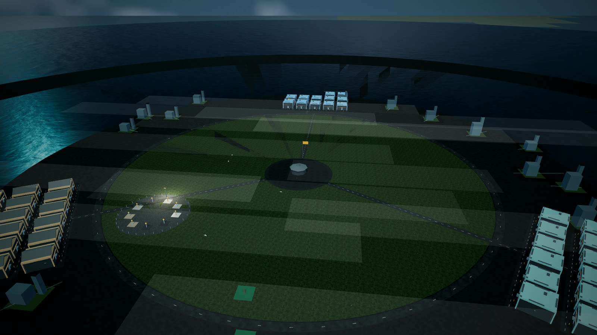

The Treasure Island campus green and its halls, rising from low over the green to a high three-quarter view

- **Duration:** 7 s at 24 fps, 1600x900; camera move: crane-up
- **Filmed on:** `web/trade_craft_3d.html`, campus:treasure-island
- **Files:** [mp4](../web/media/broll/campus-green-crane-up.mp4) (2.2 MB) · [webm](../web/media/broll/campus-green-crane-up.webm) (1.8 MB) · [480 px preview](../web/media/broll/campus-green-crane-up-480.webm) (156 KB)
- **Provenance:** RECORDED from this build (commit 57f497245b0d); licence first-party; status: committed source
- **Known issue:** shadow striping on the green and the water once the camera climbs past about 120 m (second half of the move); not hero quality - re-shoot lower

### Campus green, low lateral dolly

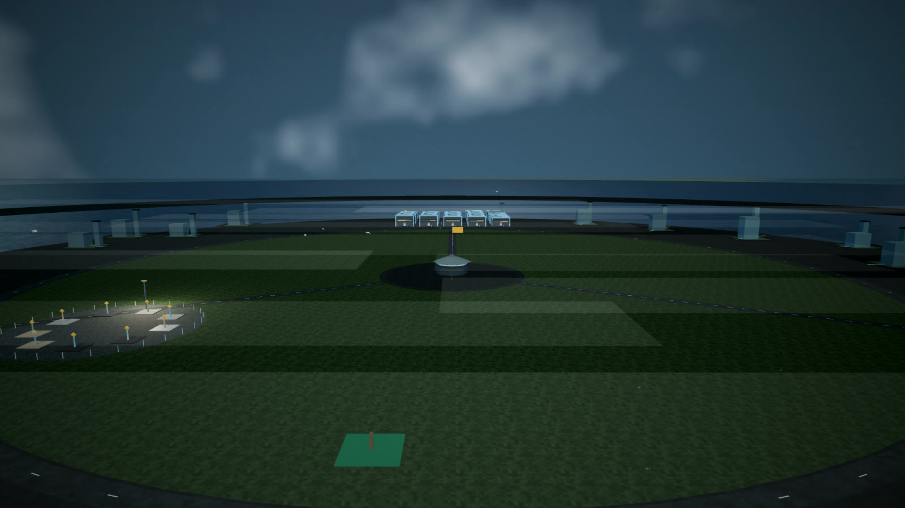

The Treasure Island campus green and its training yard, the camera sliding sideways low over the green

- **Duration:** 6 s at 24 fps, 1600x900; camera move: lateral dolly (low)
- **Filmed on:** `web/trade_craft_3d.html`, campus:treasure-island
- **Files:** [mp4](../web/media/broll/campus-green-low-dolly.mp4) (1.0 MB) · [webm](../web/media/broll/campus-green-low-dolly.webm) (652 KB) · [480 px preview](../web/media/broll/campus-green-low-dolly-480.webm) (54 KB)
- **Provenance:** RECORDED from this build (commit 57f497245b0d); licence first-party; status: committed source

### Region board, slow orbit

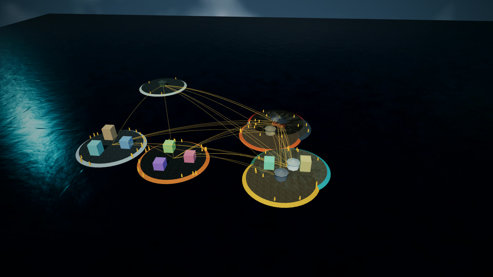

The ten-campus region board turning slowly under a high three-quarter camera

- **Duration:** 6 s at 24 fps, 1600x900; camera move: orbit
- **Filmed on:** `web/trade_craft_3d.html`, region
- **Files:** [mp4](../web/media/broll/region-board-orbit.mp4) (1.2 MB) · [webm](../web/media/broll/region-board-orbit.webm) (1.3 MB) · [480 px preview](../web/media/broll/region-board-orbit-480.webm) (84 KB)
- **Provenance:** RECORDED from this build (commit 57f497245b0d); licence first-party; status: committed source
- **Known issue:** the board fills about a fifth of the frame and a glint crosses the water; not used as a hero

### Hall exterior, close orbit

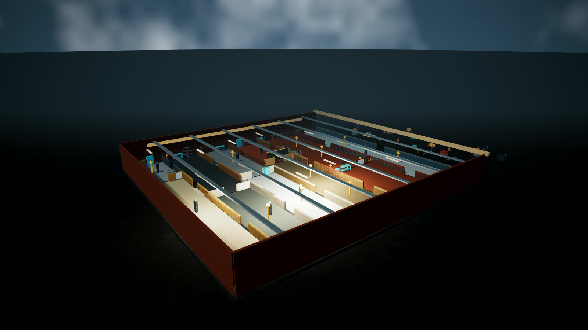

One trade hall seen from outside, the camera circling it at roof height

- **Duration:** 6 s at 24 fps, 1600x900; camera move: orbit
- **Filmed on:** `web/trade_craft_3d.html`, hall
- **Files:** [mp4](../web/media/broll/hall-orbit.mp4) (882 KB) · [webm](../web/media/broll/hall-orbit.webm) (863 KB) · [480 px preview](../web/media/broll/hall-orbit-480.webm) (102 KB)
- **Provenance:** RECORDED from this build (commit 57f497245b0d); licence first-party; status: committed source

### Hall interior, dolly over the bays

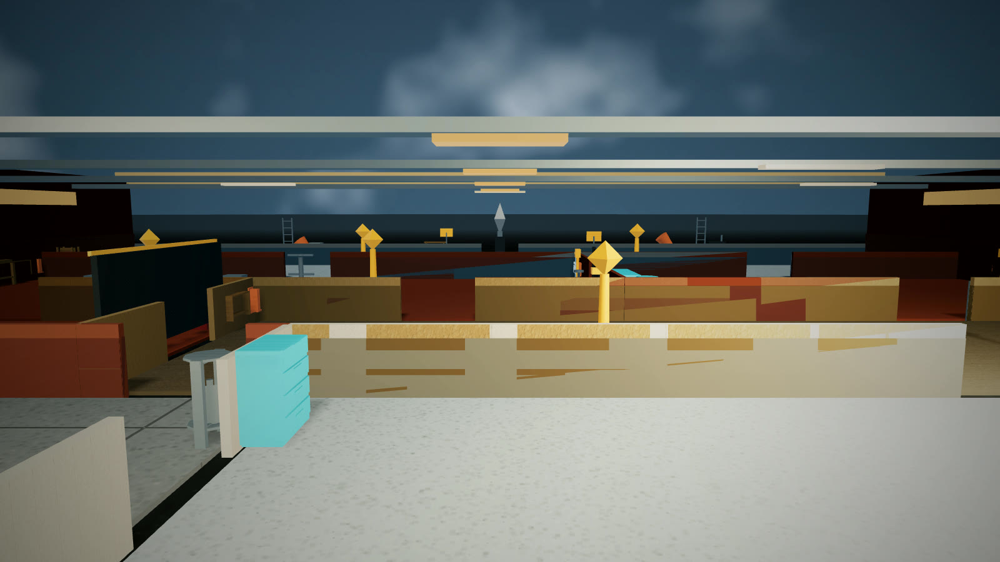

Inside a trade hall, the camera moving forward just above head height over the training bays

- **Duration:** 6 s at 24 fps, 1600x900; camera move: dolly-in
- **Filmed on:** `web/trade_craft_3d.html`, hall
- **Files:** [mp4](../web/media/broll/hall-interior-dolly.mp4) (1.5 MB) · [webm](../web/media/broll/hall-interior-dolly.webm) (1.4 MB) · [480 px preview](../web/media/broll/hall-interior-dolly-480.webm) (195 KB)
- **Provenance:** RECORDED from this build (commit a721981f0991); licence first-party; status: committed source
- **Known issue:** shadow striping on some bay walls in the foreground; not used as a hero

### Globe, slow flyover

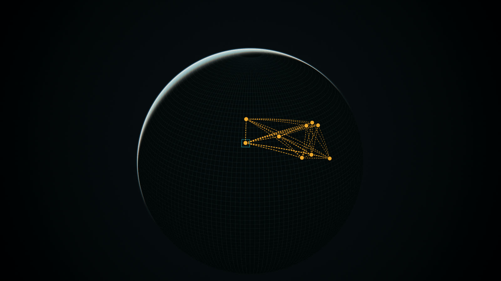

The globe map (graticule and the campus network, placed SCHEMATIC at registry coordinates) turning toward the network and easing in

- **Duration:** 6 s at 24 fps, 1600x900; camera move: flyover
- **Filmed on:** `web/trade_craft_geomap.html`, globe
- **Files:** [mp4](../web/media/broll/globe-flyover.mp4) (717 KB) · [webm](../web/media/broll/globe-flyover.webm) (610 KB) · [480 px preview](../web/media/broll/globe-flyover-480.webm) (44 KB)
- **Provenance:** RECORDED from this build (commit a721981f0991); licence first-party; status: committed source
- **Known issue:** the globe has no basemap offline, so it reads as a dark sphere with a graticule, and the network starts small in frame; not used as a hero

### High Country, mountain flyover

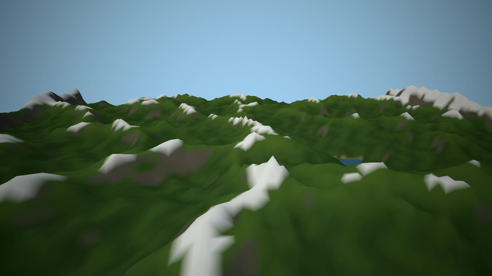

The AUTHORED High Country wild world (terrain inspired by the general geography of a high mountain range, not real elevation), the camera gliding across the ridges from high over the valley

- **Duration:** 6 s at 24 fps, 1600x900; camera move: flyover (lateral, descending)
- **Filmed on:** `web/trade_craft_wilds.html#mountain`, wilds:mountain overview
- **Files:** [mp4](../web/media/broll/wilds-mountain-flyover.mp4) (739 KB) · [webm](../web/media/broll/wilds-mountain-flyover.webm) (554 KB) · [480 px preview](../web/media/broll/wilds-mountain-flyover-480.webm) (77 KB)
- **Provenance:** RECORDED from this build (commit a721981f0991); licence first-party; status: committed source

## The explainer video

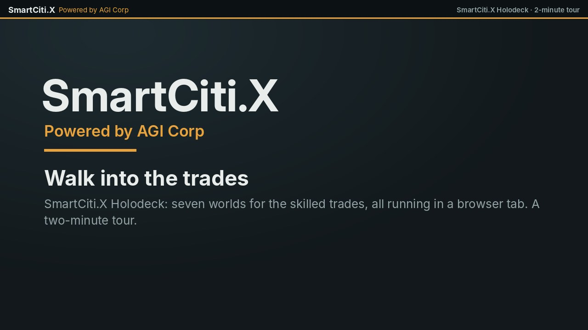

- **Watch:** [explainer.mp4](../web/media/explainer/explainer.mp4) (7.8 MB, 122 s, 1280x720 at 24 fps; audio: none)
- **Captions as text:** [explainer.captions.txt](../web/media/explainer/explainer.captions.txt) (18 lines, quoted below)
- **Provenance:** DERIVED: composed from recorded page footage and stills at 83db20b, captioned, silent
- **What it is made of:** Three recorded b-roll clips from this library (globe flyover, hall interior dolly, wilds mountain flyover), a recorded capture of the model arena, page stills, a title card, two text cards (the arena's measured success table and a how-it-is-built card) and an end card with the project contact; every caption is the registered captions text.
- **Format:** mp4 only (H.264), to keep the repository lean; no webm.
- **Figures:** The numbers spoken in the captions are those of the pages at commit 83db20b and are not refreshed here.

Captions, quoted from the file the video was composed with:

> Trade Craft Academy is a training network for the skilled trades, set in walkable worlds instead of slides.
> Everything you see here was recorded from the live pages, in a browser, with nothing installed.
> Three walkable campuses hold all 111 union training halls: Treasure Island, Oakland Waterfront and Crescent Works in New Orleans.
> Click a hall and walk in. Eleven rooms: briefing, equipment bay, tool crib, practice bays and simulator seats.
> Each hall has a scripted advisor with an avatar and a voice that starts on a click. No AI model writes what it says.
> Thirteen connected New Orleans parishes to walk, drive and boat across, with authored streets and landmarks.
> New: walk up to a hall and press Enter to go inside it in 3D, then come back to the spot you left. 29 doors here, 9 in the Bay.
> Nine connected Bay Area counties, from San Francisco and Oakland to the North Bay marshes.
> Eight walkable shoreline restoration projects, each with its own habitat scene, crew mentors and a scenario you can step through.
> The wilds: four authored landscapes, 427.9 square kilometres, where the outdoor trades work.
> 23 work sites, from a pipeline river crossing to line clearance, each linked to the halls and lessons that teach the work.
> Robots compete live on the same seeded trade task, match after match, while a harness compares every model.
> A small behaviour-cloning network, trained on scripted episodes, plays beside the reference. It is not a language model.
> Measured with 95% intervals. Omega Claw refereed 1,040 runs with no disagreements and built a 260-sample dataset for training elsewhere.
> The Omega Hive: 197 scripted agents with avatars and authored personalities. Every line is quoted from a registry.
> New: 16 hands-on modules with 191 steps send learners into the worlds: worksites, restoration sites, the wilds and the robot yard.
> 122 courses, K-12 pathways for four grade bands and 105 teacher program cards. Districts and partners are proposed.
> Lessons are unverified general practice and certify nobody. Unions named are not partners or affiliates.

## Stills

13 stills, each one screenshot of a built page. Provenance for every one: **RECORDED: captured in headless Chromium from the pages at commit 83db20b, 1280x720**.
Each still is one screenshot of the built page at that viewport width; some are cropped to a shorter height (the registry measures each file).

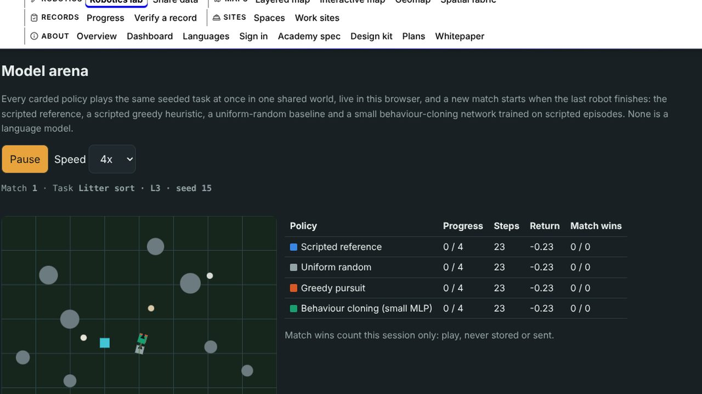

*The robotics lab (`web/trade_craft_robotics.html`), model arena: four policies on the same seeded task, live in the browser.* View: Model arena, match 1 (litter sort, seed 15); 1280x720, 77 KB.

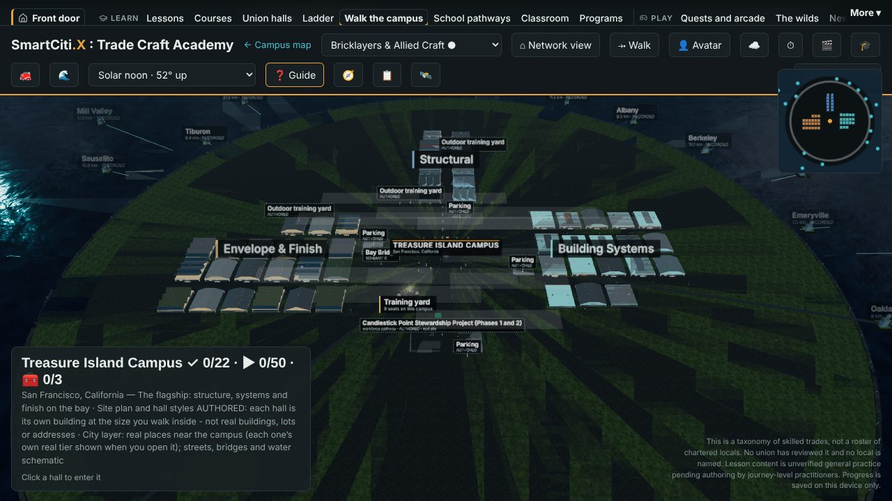

*The walkable world (`web/trade_craft_3d.html`), campus view of the Treasure Island campus: the Structural, Envelope and Building Systems hall clusters.* View: Treasure Island campus view, solar noon; 1280x720, 134 KB.

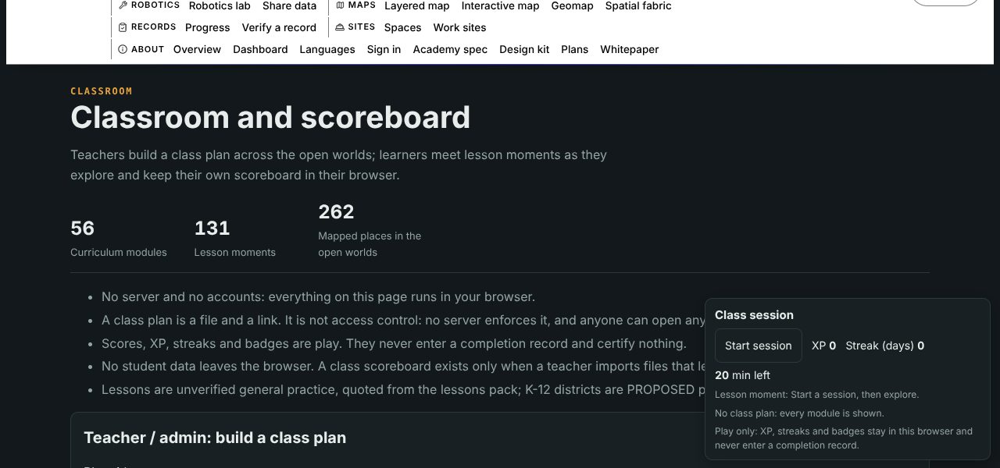

*The classroom page (`web/trade_craft_classroom.html`), top of page, with the play-only class session panel open.* View: Top of page, class session panel open; 1280x600, 82 KB.

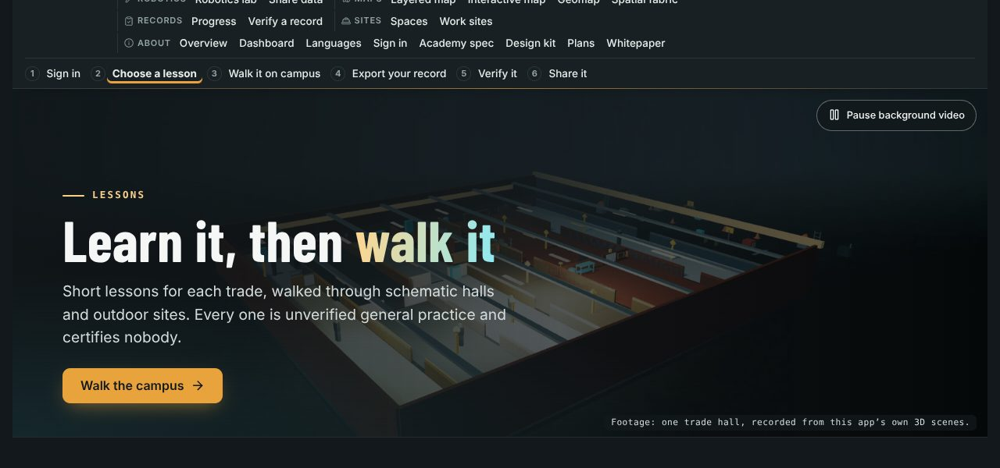

*The lessons hero band (`web/trade_craft_lessons.html`) over looping footage of one trade hall; the capture job was pointed at the Courses page, but the band in the pixels is the lessons one.* View: Lessons hero band over trade-hall footage; 1280x600, 68 KB.

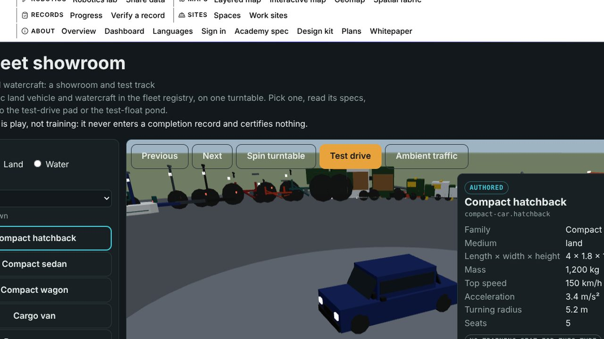

*The fleet showroom (`web/trade_craft_fleet.html`): a compact hatchback on the test-drive pad with its AUTHORED spec card.* View: Showroom, compact hatchback on test drive; 1280x720, 88 KB.

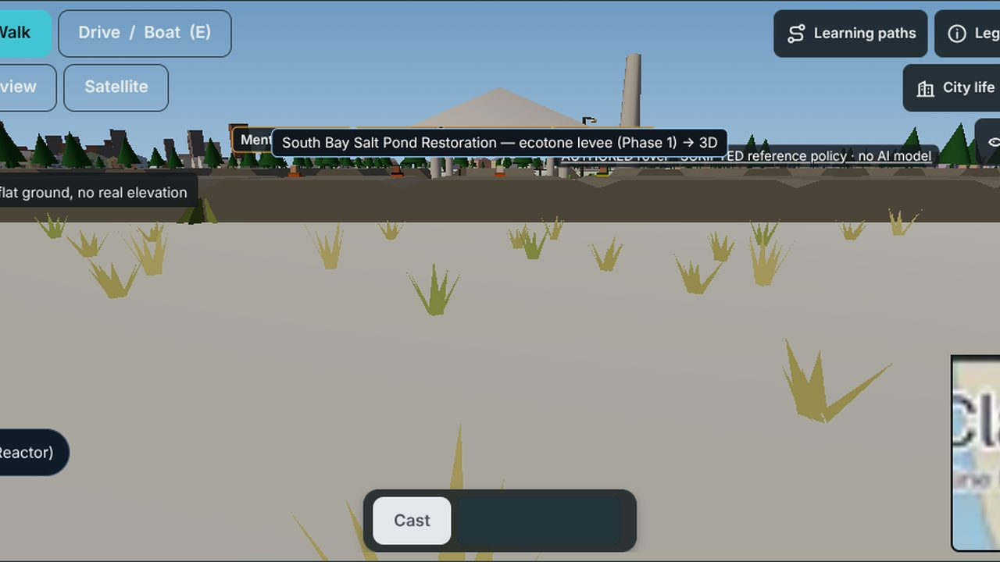

*The Bay world (`web/trade_craft_bay.html`), on foot at the South Bay Salt Pond ecotone levee restoration site.* View: Walking at the South Bay Salt Pond ecotone levee site; 1280x720, 67 KB.

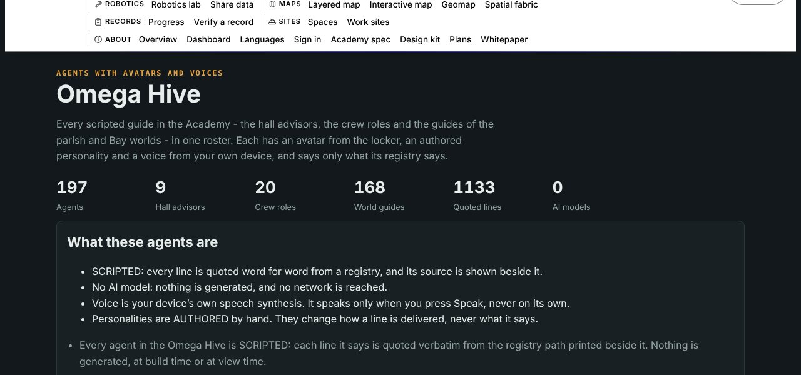

*The Omega Hive page (`web/trade_craft_hive.html`), top of page: the scripted-agent roster counts and what the agents are and are not.* View: Top of page, roster counts; 1280x600, 81 KB.

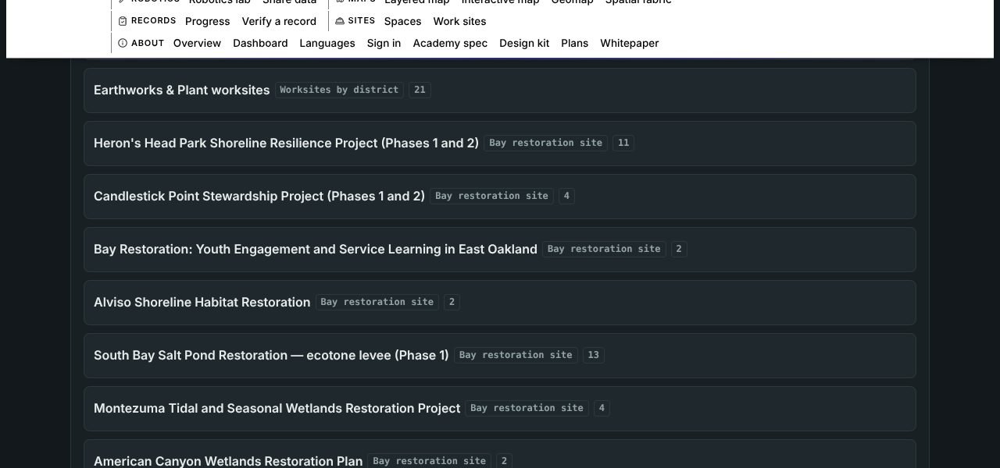

*The Courses page (`web/trade_craft_courses.html`), the world training modules list: worksite districts and Bay restoration sites.* View: World training modules list; 1280x600, 73 KB.

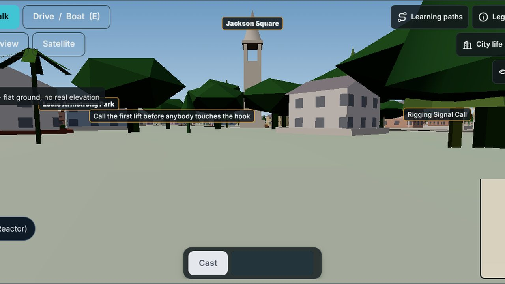

*The parish world (`web/trade_craft_parishes.html`), on foot at a hall door with the Jackson Square landmark in view.* View: Standing at a hall door in the parish world; 1280x720, 65 KB.

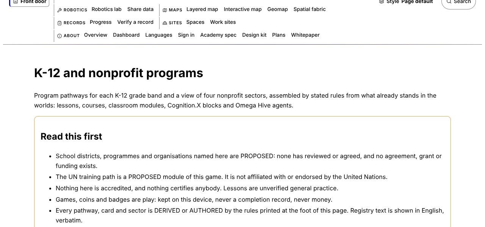

*The programs page (`web/trade_craft_programs.html`), top of page: the K-12 and nonprofit pathways and the PROPOSED-status notes.* View: Top of page, "Read this first" box; 1280x600, 92 KB.

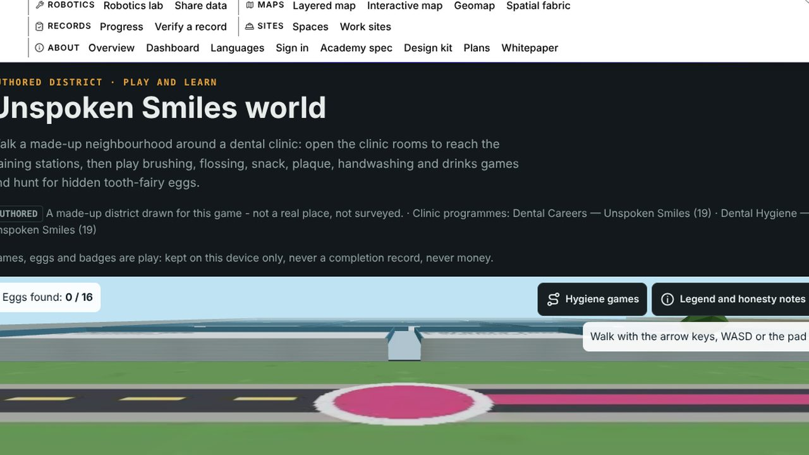

*The Unspoken Smiles world (`web/trade_craft_smiles.html`): the made-up district around the dental clinic, with the hygiene games and the egg hunt.* View: Top of page and the made-up district; 1280x720, 97 KB.

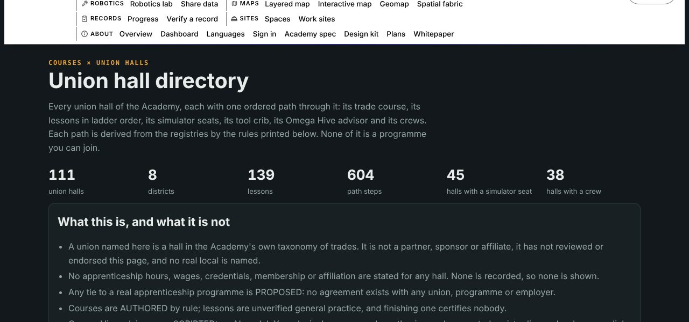

*The union hall directory (`web/trade_craft_unions.html`), top of page: the directory counts and what a named union is not.* View: Top of page, union hall directory counts; 1280x600, 83 KB.

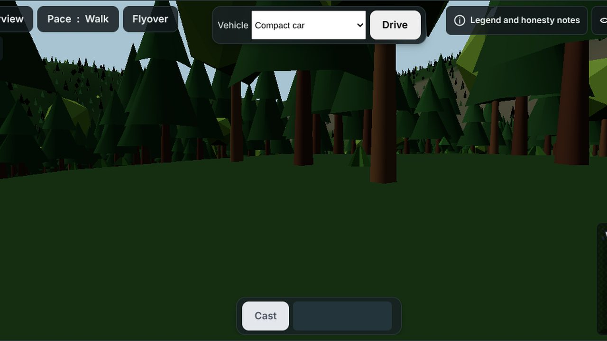

*The wilds (`web/trade_craft_wilds.html`), on foot in a forest, with the pace, flyover and vehicle controls.* View: Walking in a forest landscape; 1280x720, 57 KB.

## Builds: what landed, and when

Each row is a commit on the way to `main`, with the date it was authored and
the check count its own message states (`not stated` where the message gives
none). Read from `wiki/registry/builds.json`, which is typed from the history
once, so this page stays checkable without a repository history at hand.

| Wave | Commit | Date | What it shipped | Checks stated | Merged in |
|---|---|---|---|---|---|
| 16 | [`f20ca33`](https://github.com/AGIFutureFoundation/SmartCiti.X/commit/f20ca33) | 2026-10-12 | Wave 16 landing 1: robotics replay and reachable level, wilds flora, geomap hillshade, Bay shore depth | 6,337 | [#108](https://github.com/AGIFutureFoundation/SmartCiti.X/pull/108) |
| 16 | [`f42a9b0`](https://github.com/AGIFutureFoundation/SmartCiti.X/commit/f42a9b0) | 2026-10-12 | Wave 16 landing 2: Trade Craft courses and supplements, Omega Hive voiced agents, building and campus dressing | 6,543 | [#108](https://github.com/AGIFutureFoundation/SmartCiti.X/pull/108) |
| 16 | [`ae17cb3`](https://github.com/AGIFutureFoundation/SmartCiti.X/commit/ae17cb3) | 2026-10-12 | Wave 16 landing 3: packs list Courses and the Omega Hive, crew-role hook, relief parked in the overview, README lessons row | 6,570 | [#108](https://github.com/AGIFutureFoundation/SmartCiti.X/pull/108) |
| 17 | [`c066319`](https://github.com/AGIFutureFoundation/SmartCiti.X/commit/c066319) | 2026-10-12 | Wave 17 landing 1: Omega Hive agents embodied, furnished hall interiors, device-tier world textures, readable hillshade | 6,632 | [#108](https://github.com/AGIFutureFoundation/SmartCiti.X/pull/108) |
| 17 | [`43c063d`](https://github.com/AGIFutureFoundation/SmartCiti.X/commit/43c063d) | 2026-10-12 | Wave 17 landing 2: building exteriors, campus trees, solid street detail, all-hall interior sweep | 6,657 | [#108](https://github.com/AGIFutureFoundation/SmartCiti.X/pull/108) |
| 17 | [`834434b`](https://github.com/AGIFutureFoundation/SmartCiti.X/commit/834434b) | 2026-10-12 | Wave 17 landing 3: street-level detail in the parish and Bay worlds | 6,670 | [#108](https://github.com/AGIFutureFoundation/SmartCiti.X/pull/108) |
| 18 | [`aff302b`](https://github.com/AGIFutureFoundation/SmartCiti.X/commit/aff302b) | 2026-10-12 | Wave 18 landing 1: union-hall pathways, K-12 programs and nonprofit sectors, deep Bay restoration sites, SEO whitepaper page | 6,806 | [#108](https://github.com/AGIFutureFoundation/SmartCiti.X/pull/108) |
| 18 | [`c2d6a97`](https://github.com/AGIFutureFoundation/SmartCiti.X/commit/c2d6a97) | 2026-10-12 | Wave 18 landing 2: robot model arena with a trained BC policy, Omega Claw datasets, union directory, Programs page, solid levees | 6,996 | [#108](https://github.com/AGIFutureFoundation/SmartCiti.X/pull/108) |
| 18 | [`3a5a889`](https://github.com/AGIFutureFoundation/SmartCiti.X/commit/3a5a889) | 2026-10-12 | Wave 18 landing 3: a robot yard in the parish and Bay worlds | 7,001 | [#108](https://github.com/AGIFutureFoundation/SmartCiti.X/pull/108) |
| 19 | [`83db20b`](https://github.com/AGIFutureFoundation/SmartCiti.X/commit/83db20b) | 2026-10-12 | Wave 19: world training modules, a shared realistic look, and doors in and out of the worlds | 7,201 | [#108](https://github.com/AGIFutureFoundation/SmartCiti.X/pull/108) |
| 20 | [`d8094b8`](https://github.com/AGIFutureFoundation/SmartCiti.X/commit/d8094b8) | 2026-10-19 | Wave 20 landing 1: crew lessons completable, mocked WebXR session, module links in the worlds, parish view cull, roadmap v3.6 and v3.7 | 7,339 | [#109](https://github.com/AGIFutureFoundation/SmartCiti.X/pull/109) |
| 20 | [`b51f651`](https://github.com/AGIFutureFoundation/SmartCiti.X/commit/b51f651) | 2026-10-19 | Rebuild registries after the main merge (README headline count) | 7,388 | [#108](https://github.com/AGIFutureFoundation/SmartCiti.X/pull/108) |
| 20 | [`b098362`](https://github.com/AGIFutureFoundation/SmartCiti.X/commit/b098362) | 2026-10-19 | Wave 20 landing 2: walk and placard evidence, campus and network brightness, guide cull, roadmap v3.7 status | 7,405 | [#109](https://github.com/AGIFutureFoundation/SmartCiti.X/pull/109) |
| 21 | [`b81d6e2`](https://github.com/AGIFutureFoundation/SmartCiti.X/commit/b81d6e2) | 2026-10-19 | Wave 21 checkpoint: station and crib episodes, mocked-session seat harness, inland water skip, worksite module links | not stated | [#109](https://github.com/AGIFutureFoundation/SmartCiti.X/pull/109) |
| 21 | [`4459f74`](https://github.com/AGIFutureFoundation/SmartCiti.X/commit/4459f74) | 2026-10-20 | Evidence strength by step kind, and a separate consent scope for lesson-activity data | 7,829 | [#109](https://github.com/AGIFutureFoundation/SmartCiti.X/pull/109) |
| 21 | [`2f826bd`](https://github.com/AGIFutureFoundation/SmartCiti.X/commit/2f826bd) | 2026-10-20 | Roadmap: lead the lesson evidence line with the graded figure | 7,829 | [#109](https://github.com/AGIFutureFoundation/SmartCiti.X/pull/109) |

The merge commits on `main`:

| Pull request | Merge commit | Date | Title | Checks stated |
|---|---|---|---|---|
| [#107](https://github.com/AGIFutureFoundation/SmartCiti.X/pull/107) | [`6f88380`](https://github.com/AGIFutureFoundation/SmartCiti.X/commit/6f88380) | 2026-10-19 | Merge pull request #107: the roadmap loop (cycles 1 to 5: course pack, agent loop, eval gates, safety gate, review fixes) | not stated |
| [#108](https://github.com/AGIFutureFoundation/SmartCiti.X/pull/108) | [`7ae6818`](https://github.com/AGIFutureFoundation/SmartCiti.X/commit/7ae6818) | 2026-10-19 | Merge pull request #108: waves 16 to 19 (courses and the Omega Hive, world detail, robot arena, programs, whitepaper, training modules) and the README links | not stated |
| [#109](https://github.com/AGIFutureFoundation/SmartCiti.X/pull/109) | [`dfa7e0a`](https://github.com/AGIFutureFoundation/SmartCiti.X/commit/dfa7e0a) | 2026-10-19 | Merge pull request #109: waves 20-21 (lesson evidence by strength, consented activity data, mocked VR session, module links, view culls) | 7,829 |

## Also published privately

A whitepaper and a video tour are also published privately and are shared on
request; they are not linked from this repository.

## The honest limits

- The stills and the b-roll are RECORDED from the pages; the explainer is DERIVED, composed from that footage and those stills, and silent.
- Every figure spoken or shown in the explainer is the figure of the pages at the commit it was recorded from; none is refreshed here.
- Where a clip is pending this page says so, and a clip with a known issue is never offered as hero quality.

---

*Generated by `wiki/build_wiki.py` from the verified registries — edit the sources, not this page. Adaptive Stack v3.2 · pack 3.2.0.*
